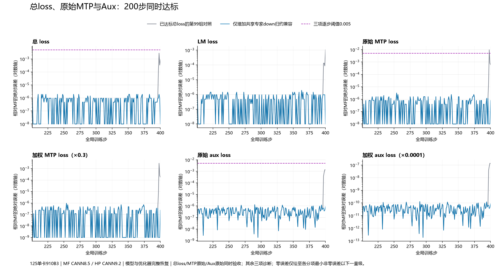

# JT 单卡 MF200→MF/HP400：总 loss、MTP、Aux 三项同时达标

第 100 组独立 200 步实验 `hp-jte213-shareddown396400` 已退出 0，三项逐步门槛全部通过。
从同一次 MF200 **完整模型和优化器状态**恢复，MF、HP 独立续训 201–400；HP 不读取 MF 续训参考权重、梯度或 loss 修正训练。

## 最终验收

| 绝对误差 | 第201步 | 200步最大值 | 最大差所在步 | 第400步 | 超0.005步数 |
|---|---:|---:|---:|---:|---:|
| 总 loss | 9.5367431640625e-7 | 1.9073486328125e-6 | 210 | 0 | 0/200 |
| 未加权 MTP | 7.947285975973273e-7 | 3.1789143886129523e-6 | 254 | 7.947285975973273e-7 | 0/200 |
| 未加权 Aux | 5.8673322200775146e-8 | 1.2973323464393616e-6 | 290 | 8.675269782543182e-7 | 0/200 |

总 loss 首步保留最早的严格门槛 0.0005；MTP/Aux 首步各 0.001；三项 200 步每一步各 0.005。
MTP 系数仍为 0.3，Aux 为 1e-4。原始 MTP 由记录的加权值除以 0.3；MF Aux 已是原始值，HP Aux 除以 1e-4。
这个口径保留 FP32 记录的舍入，不承诺与乘系数前张量逐位相同；它与历史全部消融一致。
不平均掉坏步，不用加权后的小误差代替原始分项；每步额外核对 LM/MTP/Aux 重组总和，容差 2e-5。

[完整200步审计](evidence/frontier396-shared-independent200-audit.json) · [独立三项门槛](evidence/frontier396-three-loss-acceptance.json) · [原始指标](runs/hp-jte213-shareddown396400/metrics.jsonl) · [100组完整实验](evidence/completed-cann92-inventory.csv)

## 最后一个未达标因素及优先级

第 99 组总 loss、Aux 已过线，唯一未过线的是 MTP 第 398 步，误差 0.009670257568359375。
因此优先定位这个会改变验收结论的因素，没有先处理 Aux 中更小的残差。

| 本阶段受控单因素 | 对照第99组最大误差 | 仅加共享专家down归约的第100组 | 超限步变化 |
|---|---:|---:|---|
| 总 loss | 0.00276947021484375 | 0.0000019073486328125 | 0→0 |
| 原始 MTP | 0.009670257568359375 | 0.0000031789143886129523 | **1→0** |
| 原始 Aux | 0.001382586546242237 | 0.0000012973323464393616 | 0→0 |

只新增 `(5120,3072)` 共享专家 down 的实时平方和归约，所有步、主干/MTP 两处均执行，每步两次。
epsilon、NS 迭代和系数、梯度裁剪、学习率、数据、恢复状态及既有因素保持。没有目标 loss、步号或坐标特判。
MTP 最大误差下降约 99.967%；该收益只适用于第99组背景，不能声称原始 HP 单加此因素即可过线。

最近几组的实际增量和负面结果也保留：

| 完整实验 | 唯一增量/背景 | 总loss最大误差 | 超0.005步数 | 解释 |
|---|---|---:|---:|---|
| #96 | 最新一轮固定JT来源、Q-up背景 | 0.0567522048950 | 13 | 对照 |
| #97 | 再加dense fc1归约 | 0.0216159820557 | 8 | 减少最大误差，但最后一步曾退步 |
| #98 | 再加Q-up RoPE归约 | 0.0227727890015 | 3 | 最大误差反增5.35%，超限步减少，不能只报有利指标 |
| #99 | 再加专家down归约 | 0.00276947021484 | 0 | 总loss过线，MTP仍1步超限 |
| #100 | 再加共享专家down归约 | 0.00000190734863281 | 0 | 三项同时过线 |

这是有依赖的逐项消融，不是全因子实验；不同背景的收益不能线性相加或当成全局重要性排名。
当前阻塞项优先于微小差异；已通过三项门槛后停止扩展无必要的低影响实验。
更早的输出头 GEMM、CE、位置/MTP 语义、加权专家梯度、Muon/AdamW 算术等，保留在历史总报告和100组配置/指标中。

## 从训练边界定位到代码/算子

1. 350、375、390、395 的全部 48 项模型 FP32/BF16 哈希精确；396 更新后首次只有主干第1层共享专家 down 不同。
2. 396 的全部 46 项裁剪前梯度、平方和和全局范数精确，目标裁剪后梯度与新动量也精确，排除上游梯度和恢复状态。
3. 两端各自原更新独立重放，完整权重/动量精确复现真实训练；归一化前输入原生哈希相同。
4. 首差在旧 MF 原生 `Cast_Mul_ReduceSum_split-op0` 的平方和归约/开方，随后产生 92,955 个 BF16 normalized 差异。
5. 只替换实时归约顺序，完整 15,728,640 个权重值精确等于 MF。396 原有 9,556,275 个 FP32位差、117,828 个 BF16差消失。
6. 新因素完整200步通过；独立197步观察与其前缀指标逐值相同。396、397的全部46项梯度、平方和、范数精确，六个观察点的48项模型 FP32/BF16也精确。

**200步全局梯度范数全部精确一致。** 模型完整哈希只在实际采集的六个观察点验证，未把它外推成所有200步模型都逐位一致。

精确位置：MF归档 `mindformers/core/optim/muon.py::zeropower_via_newtonschulz5_2d` 的 `x/(x.norm()+1e-7)`；
HP实验 `muon_jit_probe.py::graph_jit_ns` 及 `hp_ns_epsilon229_factor.py`；候选 `hp_shared_down396_factor.py::normalized_shared_down`。
DVM实测调度为9776元素/块、1609块、尾8832、16 lanes、40 vector cores。不是由打印小数猜测：原生IR、统计SHA与完整值重放共同验证。

[完整因果链](evidence/frontier396-causal-chain.json) · [原生396/397统计比较](evidence/frontier396-shared-native-statistics-comparison.json) · [详细定位过程](阶段记录-MTPAux397边界定位.md) · [准确位置与行业对照](阶段记录-396归一化正确性与行业对照.md)

## 哪边正确，与最新行业实现如何对应

普通 HP norm 为0.22601467370986938，MF为0.2260146588087082，FP64参考为0.22601466135891418。
MF的norm更近FP64，但92,955个不同的BF16 normalized值全部是普通HP结果更近FP64。
因此该因素证明的是**旧MF编译图兼容差异**，不是HP普通norm存在已证明的数学缺陷；不能用loss更接近MF替代正确性判断。

2026-10-16重新核实的官方来源见[head和源码哈希回执](evidence/frontier396-latest-industry-heads.json)：

- MF master PyNative `1c9258ca`：FP32 norm、`clamp(norm,min=eps)`、除法后转BF16，后续融合addmm。
- Megatron-LM `3e2807ce`：Muon委托Emerging Optimizers。
- NVIDIA Emerging Optimizers `4bbed19e`：FP32输入，默认functional.normalize，可选FP64 norm；BF16迭代受matmul precision控制。

这些当前实现均不要求旧DVM固定tile/core归约。`clamp(norm,eps)`与`norm+eps`是不同定义，本次未改变epsilon语义。
固定形状、CPU参与的兼容原型保持显式隔离，不设为通用优化器默认，不作性能承诺。

## 配置、版本和完整恢复

| 项目 | 实际配置 |
|---|---|
| 设备 | 125实际Ascend910B3；每组单卡；独立实验卡4/5、端口31717/31718；未动zth，未停止xxl2 |
| MF | 用户指定归档，源码未编辑；MindSpore2.7.2、CANN8.5.0；原包无Git信息，不伪造版本提交 |
| HP受控训练 | JT_dev `e21302f9e7b47d41b61f5f4987fc34c000f7c978`＋PR192集成 `181fab5f5c31ceeb2e385c1267aa586d5c6c8835`；含PR180；与第99组固定同源 |
| HP运行时 | torch/torch_npu2.12、Python3.12、CANN9.2.0-beta.2；editable导入路径/实际库核验 |
| 数据 | 4K Arrow，4710条；续训同200条，104条包含多文档；真实输入逐步核验 |
| 模型 | 2主decoder＋1MTP，hidden5120、vocab152064、denseFFN12288、MoEFFN1536，8路由＋2共享，top2 |
| 训练 | 所有并行度1、batch1、seed42；FP32主参数/BF16计算；既有剪裁、归约和位置/MTP兼容保持 |
| Muon | lr1e-4、wd0.1、momentum0.95、Nesterov、NS5 legacy、eps1e-7、matched_adamw_rms0.2、QKclip100 |
| AdamW | lr1e-4、wd0.1、betas(0.9,0.95)、eps1e-8，norm不衰减 |

当前承接库YAML的Muon＋AdamW混合配方，不把更早全AdamW阶段混入本次验收。
MF200→HP离线转换使用PR166映射；独立审计完整验证48模型、28Muon动量、18一阶＋18二阶AdamW槽，step和数据游标均200；
首次前向前又检查实际内存。没有用“只恢复模型”的实验解释此次误差。

最新上游JT_dev另已合入PR232，head为`a1e6c222`，取消确定性设置对K-shift的接管，针对#187采用不同于PR192的修法。
本次为保持第99组单因素对照，没有中途换该代码；不会把本轮完整200步结果冒记成`a1e6c222`的真机验证。

[最终YAML](configs/hp-jte213-shareddown396400.yaml) · [完整恢复](runs/hp-jte213-shareddown396400/RESTORE.json) · [离线恢复独立审计](evidence/optimizer-restore-independent-reaudit.json) · [冻结和新增源码清单](evidence/frontier396-final-source-manifest.json)

## 修改、独立issue/PR与验证范围

总问题为[#217](https://github.com/hf1s/hyper-parallel/issues/217)。必要产品修改保持独立：
token恒等权重#216→PR180、K-shift配置#187→PR192（上游另以PR232合入解耦方案）、Muon单分片精度#215→PR213。
最新共享专家归一化已提交独立中文[子问题#240](https://github.com/hf1s/hyper-parallel/issues/240)与[PR#241](https://github.com/hf1s/hyper-parallel/pull/241)，详细区分归档兼容与现代正确性。
| 独立问题 | PR | 当前状态与范围 |
|---|---|---|
| [#216 token恒等权重](https://github.com/hf1s/hyper-parallel/issues/216) | [#180](https://github.com/hf1s/hyper-parallel/pull/180) | 已合入JT_dev，当前训练基线包含 |
| [#187 K-shift接管](https://github.com/hf1s/hyper-parallel/issues/187) | [#192](https://github.com/hf1s/hyper-parallel/pull/192)；上游另采用[#232](https://github.com/hf1s/hyper-parallel/pull/232) | #192仍开放；#232已合入，二者方案不同，不混同本轮训练版本 |
| [#215 Muon单分片精度](https://github.com/hf1s/hyper-parallel/issues/215) | [#213](https://github.com/hf1s/hyper-parallel/pull/213) | 开放，既有212UT/真实NPU回归证据见PR；不是已合入 |
| [#240 共享down归一化兼容](https://github.com/hf1s/hyper-parallel/issues/240) | [#241](https://github.com/hf1s/hyper-parallel/pull/241) | 新增独立诊断CLI和中文正确性说明；一个提交、两个example文件 |

#192/#213/#241发布前当前head均无check-runs或commit-status条目，状态pending；未宣称CI绿色。已合入状态直接依据GitHub merge字段。
历史[总差异#190](https://github.com/hf1s/hyper-parallel/issues/190)、[#149](https://github.com/hf1s/hyper-parallel/issues/149)、[#150](https://github.com/hf1s/hyper-parallel/issues/150)、[#152](https://github.com/hf1s/hyper-parallel/issues/152)、[#153](https://github.com/hf1s/hyper-parallel/issues/153)、[#154](https://github.com/hf1s/hyper-parallel/issues/154)、[#155](https://github.com/hf1s/hyper-parallel/issues/155)、[#156](https://github.com/hf1s/hyper-parallel/issues/156)、[#210](https://github.com/hf1s/hyper-parallel/issues/210)继续按原分类复用。
其中框架精度选择/归档行为不自动变成需改默认的缺陷，旧MF缺陷也不虚构成当前MF master仍有同一问题；本轮最新行业源码复核针对新确认的归一化边界。397传播差不重复开多个问题。

新诊断工具验证16项检查通过：完整真实输入、MF原生normalized哈希、已执行训练因素逐元素等价、norm/FP64参考、
CLI和输入保护；对应[真机验证回执](evidence/frontier396-pr-diagnostic-validation.json)。它只输出统计/hash，不更新模型。
这是诊断复现交付，不宣称替换产品默认即可得到同样轨迹。开放PR的CI结果另按当前head核查，不用实验通过冒充CI绿色。

## 审计修正、清理与复现

保留所有失败证据：HP首版观察器在训练前触发源码检查，r2仅修正包装顺序；无失败训练数值混入。
首次完整审计错误要求旧epsilon调用流逐字相同，新因素实际每步接管两次共享down归一化，epsilon值没有变。
v2逐步验证这400次调用被一一接管、其余形状调用完全不变，同时保留原脚本和失败日志。
所有49份冻结训练来源、输入、恢复、配置及其余因素检查通过，训练产物未改写。

396阶段11个目标数组在完成全部重放、完整200步、独立观测与PR工具验证后删除，清理692,061,568字节；
诊断CLI临时输入另清理62,914,688字节，合计754,976,256逻辑字节。
删除前核实精确路径、归属、单链接、无打开文件和完整证据；MF200、HP离线200、共享原数据保留。
原生IR/CSV、逐步指标、完整hash、配置、源码和每文件清理回执保留；不保存不再需要的全量Dump。

[清理回执](evidence/frontier396-completed-state-cleanup.json)。此前293/306/328/329阶段已清理12.23GB，历史回执仍在。

复现需原始数据与MF200 checkpoint：按最终启动脚本重建路径/运行时，先验证完整转换和实际输入，执行独立200步，
再运行`compare_shared_down396_full200_v2.py`和`check_loss_acceptance.py`。需要重放已清理的396目标值时，先用公开采集入口重建；hash不能代替数组。
独立197步观察使用`compare_shared_down396_statistics.py`核对，不能用单步replay代替训练验收。

验证范围是指定种子、单卡、4K配方、910B3与两个指定CANN版本；没有910C、多卡、其他形状或性能结论。
当前三项数值目标已通过，总issue保留开放以追踪产品PR和审阅，不自动关闭。
