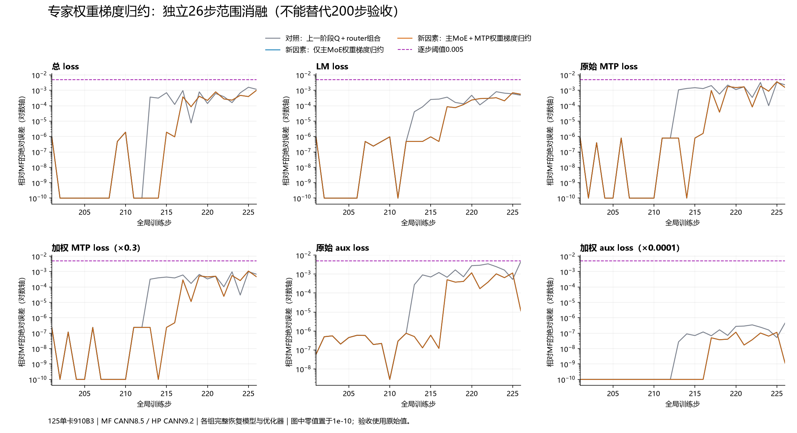

# 第212步专家权重梯度首差：完整因果链、归约重放与优先级

关联中文总问题 [#217](https://github.com/hf1s/hyper-parallel/issues/217)。本阶段聚焦前一阶段组合方案首次出现模型差异的第212步，保留负面结果与无效重放。79组独立完整200步仍未全部满足六项误差要求；本阶段新增的26步实验不能替代完整200步验收。

## 配置、基线与验收口径

- 仅125的910B3单卡；未修改zth目录，未停止xxl2任务。
- MF使用用户指定压缩包，MindSpore2.7.2/CANN8.5.0；HP使用JT_dev `f637ef7ee4d4b416800716f1ebaaae7709b8a06a`＋PR192集成`9213a97147020fb75e7a98a40f7e7b636f98d349`，已含PR180，torch/torch_npu2.12/CANN9.2.0-beta.2。本阶段再次查询JT_dev，提交未变，见[版本检查](evidence/weighted212-industry-heads.json)。
- 库上4K Arrow、Muon＋AdamW配方，lr1e-4、所有并行度1、HP reset_position_ids=true；沿用MF200完整模型和优化器状态恢复。该配方对应当前目标，不将最初AdamW单因素请求误写成本阶段实际配置。
- 对照为`hp-jtf637-norm208-q-router-independent226`，包含上一阶段独立NZ输出头、Q相邻归约、router NPU平方根等已冻结因素。49份基础探针不改动，新观察及本阶段因素分文件保存。
- 同时记录total、LM、原始/加权MTP、原始/加权aux。首步检查0.001并保留更严0.0005口径，随后每一步各项≤0.005；不只看最后一步或均值。

可复现配置和命令分别位于`configs/`与`launchers/`；每个任务有独立设备、端口、日志、输出目录和启动记录。所有比较先检查进程退出码、实际输入、完整恢复及只读观察保真，之后才使用数值差异。

## 先排除错误归因：范数不同不是独立根因

上一组只读模型哈希显示201–211全部48项FP32/BF16状态一致，212出现38项FP32、29项BF16状态不同。本阶段分别观察两侧全部46个裁剪前梯度：211全部一致；212有24项一致、22项不同。12步loss、范数、输入及恢复与各自原基线逐值一致。

|第212步|HP|MF|
|---|---:|---:|
|训练实际梯度范数|10.83714771270752|10.837157249450684|
|分别对各自原始梯度做FP64平方和开方|10.837153373666503|10.837162894781903|

FP64范数仍相差9.5211154e-6，已能解释实际范数差的大部分。这里两侧输入梯度本来就不同，不能把这个表当成“同输入norm算子精度比较”，更不能据此直接修改全局裁剪。证据：[preclip212-comparison.json](evidence/preclip212-comparison.json)。

## 从22个参数追到一个专家权重梯度

只读打点进一步完整核验主MoE输入、上游梯度、路由权重、routed/shared分支及路由归一化前后值。新增观察没有改变对应基线轨迹：两组主分支观察还分别验证211/212全部46个裁剪前梯度；路由分数观察的MF组仅验证完整主分支及12步指标，没有额外声称它也重新dump了46个梯度。

|原生边界|比较范围|不同元素|最大绝对差|
|---|---:|---:|---:|
|主MoE输入、上游梯度|各20,971,520|0|0|
|router权重|40,960|0|0|
|路由logits、sigmoid分数|各32,768|0|0|
|归一化辅助分支输出、其上游梯度|各32,768|0|0|
|选中专家及其系数|8,192个选择|0|0|
|专家权重梯度|8,192|1|1.4901161193847656e-8|
|归一化反向输出/分数梯度|32,768|2|3.87863110518083e-8|
|router logit梯度|32,768|2|1.7018848552652344e-9|
|router输入梯度|20,971,520|5,120|1.305240360238713e-10|
|routed分支输入梯度、shared分支输入梯度|各完整数组|0|0|
|主MoE合并输入梯度|20,971,520|6个BF16|3.725290298461914e-9|

只替换router输入梯度做离线加法重建，即可完整重建MF的主MoE输入梯度。两侧真实加法顺序都能用各自分支数组完整重建。HP观察到的主MoE输出是FP32分支和，MF是BF16边界；**把HP输出舍入到BF16后全数组一致**，原始不同精度边界的差异不另列为前向缺陷。

专家乘法的完整实际输入与上游梯度各41,943,040个实值逐位一致，权重系数也一致；原始计算另外含8个填充token、16个专家选择，重放保留这些填充项。将HP原生权重梯度按实际expert顺序逆排列后，与它的路由系数梯度全数组一致。因此首差已经收敛到相同乘法输入后的5120维归约。

证据：[主分支比较](evidence/moe212-branch-comparison.json)、[路由边界比较](evidence/router212-scores-comparison.json)、[权重梯度实际输入比较](evidence/weighted212-operands-comparison.json)。

## 单次两值干预：证实因果，仍不计验收

只在212的主router logit梯度替换两个实际差异坐标；替换前后完整数组SHA均核验，其他步不注入，不替换模型或优化器状态。结果：212全部46个裁剪前梯度、48个模型状态与MF一致；213全部48个模型状态仍一致。226再次出现46项FP32模型差异。

下表是201–226的全部六项绝对误差。对照与干预均未在本短窗口超过0.005；不能以此宣称完整200步通过。干预带有`DIAGNOSTIC_ONLY`标记。

|指标|对照最大 / 平均|两值干预最大 / 平均|平均误差变化|
|---|---:|---:|---:|
|total|0.001579284668 / 0.0003069547506|0.001013755798 / 0.0001643804403|-46.45%|
|LM|0.0008115768433 / 0.0001810789108|0.000693321228 / 0.0001111672475|-38.61%|
|加权MTP|0.0009896755219 / 0.0002537323878|0.001086950302 / 0.0001608683513|-36.60%|
|原始MTP|0.003298918406 / 0.0008457746261|0.003623167674 / 0.0005362278376|-36.60%|
|加权aux|4.60636802e-07 / 9.466715766e-08|1.171152107e-07 / 2.253837167e-08|-76.19%|
|原始aux|0.00460636802 / 0.0009466715766|0.001171152107 / 0.0002253837167|-76.19%|

原始MTP的均值下降，但最大误差从0.0032989184增加到0.0036231677；负面项保留，不用“所有指标都改善”概括。证据：[router212-dy-causal-audit.json](evidence/router212-dy-causal-audit.json)。

## 图模式、PyNative与独立归约重放

|同一份实际BF16乘积的执行路径|相对MF原生梯度不同元素|结论|
|---|---:|---|
|HP9.2常规/JIT/显式ReduceSumD，BF16及FP32求和，2D/4D、expert/token两种顺序共20种|每种1|均复现HP，接口名称或张量维度切换未解决|
|MF8.5 PyNative，直接sum或multiply＋sum|每种1|均复现HP，不能简单归因于8.5对9.2|
|MF8.5图模式，先固定实际BF16乘积，再sum；BF16/FP32输入，2D/4D|每种0|完整复现MF原生梯度|
|MF8.5图模式，把multiply＋sum作为新的整体图|4,358|新的融合边界改变了结果，不作为原生反向重放|

Profiler观测到图模式`vmain_mix_aiv`与PyNative `ReduceSum1/2/3/4`路径。原始CSV的shape/type字段为N/A，不补写猜测的kernel参数。保留[路径记录](evidence/weighted212-native-kernel-routes.json)及两份CSV。

为避免只拟合一个BF16不同值，再取完整图模式FP32求和输出。用历史已核验的半树处理方式，在80行发生奇数长度时把尾项累加到第一项，随后对64路做相邻相加：**全部8,208个FP32输出精确**。错误的“先补零到2的幂”版本在64路仍有238项FP32不同，已记录为被否决候选。16/32/128路也未全等。

同一独立计算在HP9.2 NPU上重新执行，全部8,208项FP32精确，输出SHA为`26625a097a099f447b7ff834ee460533815e85015f809322bc7e75645f98836a`。其只使用当前实际输入，无参考输出、步号或坐标特判。证据：[显式树](evidence/weighted212-explicit-trees-r2.json)、[NPU完整验证](evidence/weighted212-npu-tree-verification.json)。

首次三个孤立重放脚本误把含填充的8208个选择按8192 reshape，均已失败退出并保留日志；r2修正为保留8个填充token、16个选择后重新验证。失败运行不计为成功测试。

## 哪个更正确，业界参照如何解释

对同一实际BF16乘积进行FP64求和，在两侧原本不同的那个坐标，HP更近高精度参考，MF更近0处。FP64求和再转FP32/BF16的候选与HP仍有2项、与MF有3项不同；因此“统一提高求和精度”也不等于复现旧MF。这里不声称某侧全模型或训练质量普遍更正确。

[Megatron固定提交的未融合unpermute](https://github.com/NVIDIA/Megatron-LM/blob/3914483fd325e053797aff3fa431d4a3141139aa/megatron/core/transformer/moe/moe_utils.py#L620)让概率dtype参与乘法的类型提升，最终恢复输入dtype；并未规定旧MF图的64路相加顺序。版本与文件SHA见[参照记录](evidence/weighted212-megatron-reference.json)。本次同版本MF PyNative实际重放也得到HP结果。

因此当前发现属于**归档MF图执行路径兼容**，尚不是已证明应改变HP默认语义的数学错误。独立候选修改仅在实验探针中；不把固定5120宽度、64路树直接提交为通用产品默认实现。必要产品修复仍遵循独立中文子issue＋独立PR；既有链为[#215→PR213](https://github.com/hf1s/hyper-parallel/issues/215)、[#187→PR192](https://github.com/hf1s/hyper-parallel/issues/187)、[#216→PR180](https://github.com/hf1s/hyper-parallel/issues/216)。

## 独立因素的范围消融

仅改变专家权重梯度的求和树，保留原BF16乘法及最终BF16舍入、前向、专家输出梯度、优化器配方和其余冻结因素。分“仅主MoE”和“主MoE＋MTP”两组，从MF200完整恢复，每个续训步执行；同时观察201–226全部48模型哈希以及211/212的46个裁剪前梯度。

两组独立201–226已完成，全部输入、恢复、49份基础依赖、新因素与辅助源、26次主分支/适用组26次MTP调用均审计通过。两组的26步loss和范数、每步48项模型哈希逐值一致；也与两值teacher的26步指标及其4次模型观察精确一致，说明此窗口已用独立计算复现因果校正。

201–216全部48模型FP32/BF16精确MF；模型首差从212推迟到217。211/212全部46裁剪前梯度精确，第212步范数恢复为MF的10.837157249450684。两组全部六项均未超0.005，但原始MTP最大误差增大，不能写成全面改进。

|指标|对照最大 / 平均|仅主MoE最大 / 平均|主MoE＋MTP最大 / 平均|
|---|---:|---:|---:|
|total|0.001579284668 / 0.0003069547506|0.001013755798 / 0.0001643804403|0.001013755798 / 0.0001643804403|
|LM|0.0008115768433 / 0.0001810789108|0.000693321228 / 0.0001111672475|0.000693321228 / 0.0001111672475|
|加权MTP|0.0009896755219 / 0.0002537323878|0.001086950302 / 0.0001608683513|0.001086950302 / 0.0001608683513|
|原始MTP|0.003298918406 / 0.0008457746261|0.003623167674 / 0.0005362278376|0.003623167674 / 0.0005362278376|
|加权aux|4.60636802e-07 / 9.466715766e-08|1.171152107e-07 / 2.253837167e-08|1.171152107e-07 / 2.253837167e-08|
|原始aux|0.00460636802 / 0.0009466715766|0.001171152107 / 0.0002253837167|0.001171152107 / 0.0002253837167|



完整逐步值、26×48项状态差异和因素调用审计见[weighted212-independent26-audit.json](evidence/weighted212-independent26-audit.json)。本阶段45份新部署源文件均通过本机/125 SHA与AST检查，见[源清单](evidence/weighted212-source-manifest.json)。

两组完整201–400复验已于125服务器2026-10-16 02:58:56（UTC+8）启动：`hp-jtf637-weighted-dvm-main400`、`hp-jtf637-weighted-dvm-both400`，分别卡0/1、端口31578/31579。移除昂贵的全模型只读哈希观察，保留独立因素、完整状态恢复及逐步指标；前26步须再与本次短窗口精确核对。完整200步结果尚未产生，因此完成计数保持79。

## 当前影响排序与处理决定

|优先级|发现|依据与处理|
|---|---|---|
|最高验收优先级|完整200步六项仍未通过|79组独立完整实验仍失败；不能被本阶段算子逐位相同或26步通过取代|
|本阶段首要定位|专家权重梯度的图归约顺序|已建立同输入、完整归约、反向扩散和两值因果链；独立26步已复现因果校正，继续200步，以全窗口loss决定实际优先级|
|暂不独立修改|212全局范数差|主要跟随22个原始梯度差出现；先消除上游首差，避免混合归因|
|不列新缺陷|主MoE前向观察精度边界|HP舍入BF16后全数组一致|
|保留负面证据|额外融合multiply＋sum、补零半树及20种接口/形状切换|未复现原生目标，或虽改善局部却未验证训练收益，不送入产品默认|

这里的顺序是当前排查和验收优先级，未把仅一个坐标的局部FP64误差冒充完整训练收益。跨阶段总体排序继续保留总issue里的200步消融表。

## 全部不同的裁剪前参数

这是第212步原对照的完整22项，不按数量直接决定修复优先级；MTP全部参数、输出头以及主MoE专家/shared参数的裁剪前梯度保持精确。

|参数（MF命名）|FP32不同元素|BF16不同元素|最大绝对差|相对L2误差|
|---|---:|---:|---:|---:|
|`embedding.word_embeddings.weight`|1,731,677|1,102,171|7.58171082e-05|0.00158511171|
|`decoder.layers.0.self_attention.linear_proj.weight`|18,408,316|18,408,316|3.05175781e-05|0.00139206175|
|`decoder.layers.0.self_attention.linear_q_down_proj.weight`|3,485,652|3,485,652|1.52587891e-05|0.00266506341|
|`decoder.layers.0.self_attention.linear_q_up_proj.weight`|15,575,984|15,575,984|3.05175781e-05|0.0022744143|
|`decoder.layers.0.self_attention.linear_kv_down_proj.weight`|1,032,127|1,032,127|6.10351562e-05|0.00198636357|
|`decoder.layers.0.self_attention.linear_kv_up_proj.weight`|5,526,377|5,526,377|6.10351562e-05|0.001816455|
|`decoder.layers.0.mlp.linear_fc1.weight`|15,616,647|15,616,647|3.05175781e-05|0.000877692396|
|`decoder.layers.0.mlp.linear_fc2.weight`|1,672,605|1,672,605|0.000244140625|0.000345042797|
|`decoder.layers.1.self_attention.linear_proj.weight`|282|282|3.81469727e-06|7.78527459e-06|
|`decoder.layers.1.self_attention.linear_q_down_proj.weight`|65,120|65,120|2.38418579e-07|0.00020566639|
|`decoder.layers.1.self_attention.linear_q_up_proj.weight`|112,603|112,603|2.38418579e-07|0.000117952717|
|`decoder.layers.1.self_attention.linear_kv_down_proj.weight`|64,806|64,806|1.52587891e-05|0.000227241801|
|`decoder.layers.1.self_attention.linear_kv_up_proj.weight`|89,285|89,285|7.62939453e-06|3.68238525e-05|
|`decoder.layers.1.mlp.router.weight`|7,914|4|6.05359674e-09|3.80226665e-07|
|`decoder.layers.0.input_layernorm.weight`|5,120|2,157|4.49776417e-06|0.0015430429|
|`decoder.layers.0.self_attention.q_layernorm.weight`|1,536|644|4.19456046e-06|0.00166382925|
|`decoder.layers.0.self_attention.kv_layernorm.weight`|512|156|8.4056519e-06|0.000935511559|
|`decoder.layers.0.pre_mlp_layernorm.weight`|5,119|1,065|1.73220178e-06|0.000485183598|
|`decoder.layers.1.input_layernorm.weight`|5,113|220|3.82278813e-08|4.17779451e-05|
|`decoder.layers.1.self_attention.q_layernorm.weight`|590|10|2.13731255e-09|2.15041379e-05|
|`decoder.layers.1.self_attention.kv_layernorm.weight`|508|5|4.36557457e-08|1.0516579e-05|
|`decoder.layers.1.pre_mlp_layernorm.weight`|6|0|2.91038305e-09|8.66180384e-08|

## 存储、证据与复现边界

原始梯度、专家输入及两值诊断patch仅留在125本任务私有目录；公开证据只含脚本、配置、日志、完整哈希、聚合误差与启动记录。报告中不发布原始张量坐标和值。

本阶段裁剪前快照先去重5,808,713,728物理字节，其中NPY头不同的16项保留原始header十六进制，可用原header＋保留payload精确重建旧文件。随后6组完成观察中66个全文件SHA相同的数组改为硬链接，新增释放2,689,015,808物理字节，路径及字节均保留。累计清理/硬链接实际节省541,610,972,924字节；MF回调逐步删除的临时dump另记逻辑量，不重复加入物理节省。删除/替换前核验归属、路径、完成状态和进程打开的文件。详见[预裁剪去重](evidence/preclip212-array-deduplication.json)、[本阶段观察去重](evidence/weighted212-observation-deduplication.json)。

本机`.plot-venv`此前被自动审批阻止删除，已保留且未改用其他方式绕过。完整审计的source SHA、49冻结基础文件以及Git blob清单共同约束复现版本；该记录不宣称所有观察代码都是产品修改。


## 最小复现顺序

1. 按总issue准备同一次MF暖启动的step200模型及完整64槽状态，保持原4K Arrow顺序；两侧分别恢复，禁止只转换权重。
2. 按`evidence/weighted212-source-manifest.json`的folder字段把本阶段`scripts/`源文件部署到`tools`或`tools-f637`，49冻结依赖保持原SHA，框架使用上述固定JT＋PR192版本。
3. 在对应HP容器执行两条独立launcher，每条只用一个互不重叠的设备：

```bash
bash /alignment/phase12/run-hp-jtf637-weighted-dvm-main226.sh
bash /alignment/phase12/run-hp-jtf637-weighted-dvm-both226.sh
```

4. 只有两条退出码都是0后，在可见本任务文件的CPU Python环境执行`compare_weighted212_independent26.py`。该审计检查配置/源码、恢复、每步实际输入、完整模型观察、因素调用次数及全部六项误差；报告不能用单独截图或最后一个loss替代。
5. 孤立重放使用`replay_weighted212_mf_r3.py --mode graph`保留完整FP32输出，再运行`replay_weighted212_trees_r2.py`和`verify_weighted212_npu_tree.py`。原始大数组仅在本任务私有目录，外部复现应重新打点生成；公共SHA用于检查生成的实验上下文。

所有运行名都采用目录存在即拒绝覆盖的启动方式。首次失败重放和相应r2/r3分别保存，不能覆盖失败日志后声称首次通过。
