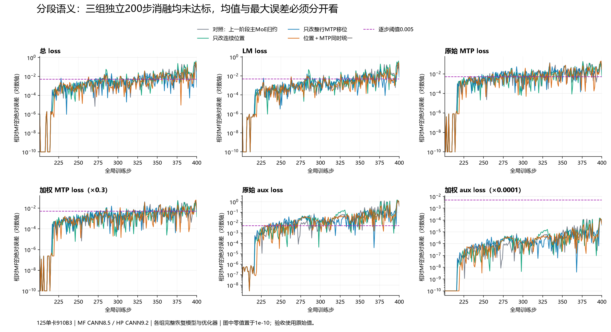

# 第 217 步首次分段批次：前向首差、独立消融与正确性排序

本阶段尚未满足完整 200 步验收。此前 81 组独立完整续训均未同时通过六项阈值，3 组参考值干预实验不计入验收。这里记录新定位到的两项分段语义差异：位置编号与 MTP 文档尾部处理。三组 26 步及对应完整 200 步独立消融均已完成，全部未达标，独立完整实验累计 84 组。新三组明确改变了位置/边界语义，属于配置兼容消融，不代表未修改的库默认配方通过。

## 与总问题、历史发现和修复的关系

总问题为 [#217](https://github.com/hf1s/hyper-parallel/issues/217)。本次复核的是已有 [MTP 子问题 #150](https://github.com/hf1s/hyper-parallel/issues/150) 和 [RoPE 子问题 #156](https://github.com/hf1s/hyper-parallel/issues/156)，追加当前 JT、当前完整状态恢复及首差证据，不重复创建同义问题。已经确认需要修改 HP 的链路仍分别是 #215→PR #213、#187→PR #192、#216→PR #180。不能为了让旧 MF 轨迹接近，就把 HP 正确的文档边界处理改成跨文档移位。

## 环境、对照与实验边界

- 服务器仅 125，硬件为单卡 Ascend 910B3。每组 TP/EP/DP/PP 均为 1，序列长度 4096、micro/global batch 均为 1，真实 4K Arrow 数据。没有访问或修改 zth 目录，没有停止其他用户作业。
- HP：JT_dev `f637ef7ee4d4b416800716f1ebaaae7709b8a06a`，加 PR #192，集成提交 `9213a97147020fb75e7a98a40f7e7b636f98d349`；CANN 9.2.0-beta.2，torch/torch_npu 2.12。MF：用户指定归档，源码保持原样，MindSpore 2.7.2 / CANN 8.5.0。
- 使用本轮既定 Muon＋AdamW 配方，MTP 系数 0.3、aux 系数 1e-4；该阶段不是历史纯 AdamW 实验。先 MF 训练到 200，独立 HP/MF 从同一完整模型和优化器状态续训。每组核对 RESTORE、实际批次、配置、源文件与调用次数。
- 本阶段对照是 `hp-jtf637-weighted-dvm-main226`；它含先前已声明的独立兼容算术因素，不等于未经修改的库默认执行路径。49 个冻结基础探针未变。本阶段只增加位置、MTP 两个相互独立因素，不把此前因素重新记作本次收益。
- 三组新因素全程基于当前输入计算，无未来模型、梯度或标签参考值注入，无坐标或步号特判。模型/梯度哈希与注意力重放只用于观察和因果检查，不把离线重放当作训练验收。
- 26 步为全局 201–226，完整窗口为 201–400；首步阈值 0.001，同时记录更严 0.0005；完整窗口六项每步都应 ≤0.005。原始与加权损失分别保留。

## 从状态恢复到前向首差的证据链

1. 上一阶段独立因素使 201–216 的全部 48 项模型张量 FP32/BF16 哈希与 MF 精确一致；217 首次不同。216 的 46/46 个完整裁剪前梯度相等，217 则 0/46 相等。该证据支持继续追前向，不能把差异直接归为优化器恢复或裁剪公式。
2. 217 原生范数 HP 为 29.813892364501953、MF 为 29.820796966552734；对各自完整梯度用 FP64 计算分别为 29.81389731800523 和 29.820800834928097。差异已经存在于裁剪输入，不是只发生在范数标量的归约。
3. 201–216 都是单段文档，217 首次出现两段，边界为 697、4096。两边输入 IDs、目标、mask、传入位置编号和有效分段在 17 个批次中均核对一致；但“传入一致”不代表“模型实际使用一致”。
4. 完整前向观察覆盖 40 个两侧可对应的 norm / 输出投影 / MoE 边界；HP 42 项记录、MF 40 个唯一边界，重计算副本也核对一致。第 0 层输入 norm、Q norm、KV norm 的输入输出全部精确。首差出现在第 0 层输出投影输入，即注意力输出。
5. 再观察实际注意力操作数：第一段文档全部精确；第二段的 Q/K 仅 RoPE 64 通道不同，Q 为 23,261,634 个元素、K 为 23,262,720 个元素。非旋转 128 通道、V、mask 均精确。注意力输出 19,308,121 个元素不同，最大绝对差 0.0078125；输出哈希与前一轮投影输入哈希完全衔接。

## 位置编号：配置语义不同，不能判定 HP 默认错误

归档 MF 的实际运行配置是 `use_eod_reset=False`。`gpt_model.py:440–443` 因此丢弃传入 position_ids；RoPE 使用整行连续位置。HP 库 YAML 的 `reset_position_ids: true` 按文档重置，JT 模型实际使用传入位置。两者对文档内部相对位置的实数数学表达等价，但有限精度下的 cos/sin 与乘加舍入不同。当前证据把差异限定为此配置不一致，不支持用“Q/K 数值差很大”推导注意力数学错误。
独立位置因素在每个续训步用连续 0..4095 替换计算入口的 position_ids；保留原本分段注意力及 MTP 边界掩码。原始批次记录仍保留，以区分数据变化与运行入口干预。该因素是复现旧归档语义的消融，不会自动成为库默认修改。

## MTP 文档尾：正确性与当前影响分开判断

归档 MF 的 roll_tensor 对整行左移，只在行末补零；输入 token、MTP labels、loss_mask 都如此。HP 基于 actual_seq_len 生成 sequence_end_mask，对每篇文档的末位置阻止跨文档移位。完整 MTP enorm 输入比较有 20,971,520 个元素，只有 5,114 个不同，且恰好位于唯一的内部文档末 token 行。数据值不公开，记录只给数量、哈希和边界归属。
本批次只改 MTP 时总 loss、LM 和 MTP loss 与对照精确相同，aux 有变化。因此不能只看“存在边界 bug”就宣称当前主 loss 的影响最大；无效目标、因果隔离和 router aux 参与统计都需要分别核对。只改 MTP 的 26 步总 loss 均值改善，但 LM/aux 有反向变化，见下表。
正确性依据：对彼此独立的 packed 文档，MTP 的未来输入与目标应保持在各自文档内。NVIDIA Megatron 的 packed 路径逐篇移位并清除越界尾部，支持 HP 现有语义。归档兼容实验关闭 HP 边界 mask 仅用于测量，不应作为修复。最新 MF PyNative 当前固定版本仍采用整行移位；这是需要判断和说明的实现局限，不能因为某参考框架也如此就认为必然正确。

## CANN 注意力前向：完整同输入反证

MF 提供长度为 129 的累计长度向量，含开头 0 和重复 4096；HP 使用有效结束位置 [697,4096]。首版审计错误地要求两种原始表示逐项相等，检查被拦住；修正审计后保留原始向量，要求单调、整数和非空文档分区一致，并进一步做实际算子重放，没有直接将两种表示视为当然等效。
在 HP CANN 9.2 上五组完整前向重放均已完成：HP 操作数＋简洁/补齐边界两组；MF 操作数＋简洁边界、补齐边界、补齐边界＋MF 最大窗口三组。每组 67,108,864 个输出元素与相应原生参考逐位精确，MF 输入重放也完整复现 MF CANN 8.5 输出。实际加载动态库均为 9.2.0-beta.2。
因此本例注意力前向的 CANN 版本、边界补齐表示和 pre_tokens 参数影响均为零，优先级降到无需继续修改。此结论只涵盖已验证的 shape / 输入 / 前向，不外推所有 CANN 算子，也不提前排除注意力反向。

## 217 单步因子拆分

|方案|总 loss 绝对差|LM 绝对差|加权 MTP 绝对差|原始 MTP 绝对差|加权 aux 绝对差|原始 aux 绝对差|
|---|---:|---:|---:|---:|---:|---:|
|对照：上一阶段仅主 MoE 归约|0.000375747680664|8.58306884766e-05|0.000289916992188|0.000966389973958|5.04863914102e-08|0.000504863914102|
|只改连续位置编号|1.90734863281e-06|9.53674316406e-07|2.38418579102e-07|7.94728596709e-07|7.69216567282e-09|7.69216567278e-05|
|只改整行 MTP 移位|0.000375747680664|8.58306884766e-05|0.000289916992188|0.000966389973958|5.81406988203e-08|0.000581406988204|
|同时改两项|1.90734863281e-06|9.53674316406e-07|2.38418579102e-07|7.94728596709e-07|8.75443223773e-12|8.75443220139e-08|

两项同时统一后的独立只读复验已完成：216/217 均为 46/46 个完整裁剪前梯度精确，201–218 全部 48 模型 FP32/BF16 哈希精确；219 首次只有 `model.layers.0.mlp.down_proj.weight` 与 `model.layers.1.mlp.experts.gate_up_proj` 不同。26 步复验与未打点组合组的全部 loss/范数、恢复、输入及配置精确；不据模型哈希推断所有优化器矩也相等。

## 26 步全窗口结果（最大差 / 平均差）

|指标|对照|只改位置|只改 MTP|同时改两项|
|---|---:|---:|---:|---:|
|总 loss|0.0010137558 / 0.00016438044|0.00126361847 / 0.000156494287|0.000722885132 / 0.000105014214|0.000935554504 / 9.59176284e-05|
|LM loss|0.000693321228 / 0.000111167247|0.000633239746 / 0.000106618955|0.000778198242 / 0.000127783188|0.000395774841 / 5.47904235e-05|
|加权 MTP|0.0010869503 / 0.000160868351|0.00129055977 / 0.000181266895|0.000535011292 / 9.54362062e-05|0.000631332397 / 7.66286483e-05|
|原始 MTP|0.00362316767 / 0.000536227838|0.0043018659 / 0.000604222982|0.00178337097 / 0.000318120687|0.00210444132 / 0.000255428828|
|加权 aux|1.17115211e-07 / 2.25383717e-08|3.71404458e-07 / 3.84573538e-08|1.77913113e-07 / 3.20992934e-08|3.31066549e-07 / 2.40703543e-08|
|原始 aux|0.00117115211 / 0.000225383717|0.00371404458 / 0.000384573538|0.00177913113 / 0.000320992934|0.00331066549 / 0.000240703543|

四组这 26 步六项都没有超过 0.005，不能据此排序为“已完成”。位置单因素的总 loss 最大差反而增大，MTP 单因素的 LM 最大差、aux 均值变差；组合虽降低总/LM/MTP 均值，aux 最大差和均值仍比对照差。所有正负结果都保留，不挑单步或单指标展示。

## 当前影响优先级与下一步

|优先级|因素|本次实测与判断|下一步 / 是否改产品|
|---|---|---|
|高|217 位置配置不一致|首个分段批次总 loss 差降低约 99.49%；完整 Q/K 差异有明确来源|完整窗总 loss 最大/均值均恶化，降级为配置对齐与因果证据，不默认改 HP|
|中|MTP 文档尾语义|217 主 loss 零变化，aux 与后续轨迹变化；组合 aux 单步降至约 8.75e-8|复用 #150；HP 保留正确边界，MF 问题单独处理，不把跨文档行为提交为 HP 修复|
|待定位|语义统一后后续仍分歧|26 步不是逐位相等；全部模型精确至218，219仅两项首差|已启动218/219两侧完整梯度哈希，优先确认反向或优化器更新来源|
|已排除于本例前向|CANN 注意力、边界补齐、窗口大小|五组完整同输入输出精确|不新增修复，不扩展为未经证明的反向结论|
|已排除为本阶段首差原因|MF200 优化器恢复遗漏|RESTORE 与完整输入保真；前 16 步全模型和 216 梯度精确|保留每组恢复审计，不再次盲试清空/替换矩状态|

## 三组独立完整 200 步：正负影响与最终优先级

三组退出码均为 0，均完成 201–400 全部 200 步；前 26 步与对应独立短实验逐项精确。模型/优化器完整恢复、200 份实际输入、相同配置（仅运行路径不同）、49 冻结源码、因素源码及每步调用计数全部通过。所有首步六项都满足更严 0.0005；但完整窗口三组均失败。

|方案|首次任一项 >0.005|总 loss 最大 / 平均|总 loss 超限步数|原始 MTP 最大 / 平均|原始 aux 最大 / 平均|
|---|---:|---:|---:|---:|---:|
|对照|233|0.193583488 / 0.0125918519|73|0.193443298 / 0.0142575035|1.3604141 / 0.0903005091|
|只改连续位置|244|0.434006691 / 0.0155668986|75|0.182641347 / 0.0135658999|1.48528495 / 0.0828621719|
|只改整行 MTP|228|0.289722443 / 0.00723504305|69|0.159385204 / 0.0127935469|1.09532863 / 0.0423634731|
|同时改两项|229|0.324404716 / 0.00834080815|51|0.207272371 / 0.0110177298|1.33345173 / 0.0493444596|

六项完整统计如下；每格为最大差 / 平均差 / 超限步数。

|指标|对照|只改位置|只改 MTP|同时改两项|
|---|---:|---:|---:|---:|
|总 loss|0.193583488 / 0.0125918519 / 73|0.434006691 / 0.0155668986 / 75|0.289722443 / 0.00723504305 / 69|0.324404716 / 0.00834080815 / 51|
|LM loss|0.16262722 / 0.00974031091 / 53|0.380605698 / 0.0124900997 / 58|0.245897293 / 0.004987427 / 42|0.262339592 / 0.00604654431 / 37|
|加权 MTP|0.0580329895 / 0.00427725106 / 41|0.0547924042 / 0.00406976998 / 40|0.0478155613 / 0.00383806407 / 42|0.0621817112 / 0.00330531895 / 31|
|原始 MTP|0.193443298 / 0.0142575035 / 108|0.182641347 / 0.0135658999 / 105|0.159385204 / 0.0127935469 / 109|0.207272371 / 0.0110177298 / 91|
|加权 aux|0.00013604141 / 9.03005091e-06 / 0|0.000148528495 / 8.28621719e-06 / 0|0.000109532863 / 4.23634731e-06 / 0|0.000133345173 / 4.93444596e-06 / 0|
|原始 aux|1.3604141 / 0.0903005091 / 130|1.48528495 / 0.0828621719 / 134|1.09532863 / 0.0423634731 / 146|1.33345173 / 0.0493444596 / 137|

组合使总 loss 平均差下降 33.76%，超限 73→51 步；但最大差上升 67.58%，首次任一项超限 233→229，原始 aux 超限 130→137 步。只改 MTP 的总 loss 平均差下降 42.54%，却更早在 228 超限且最大差上升；只改位置的总 loss 均值恶化 23.63%。因此不能把首差推进或均值改善写成完整达标，也不能将兼容旧 MF 的跨文档移位作为 HP 默认修复。

更新后的排序：第一优先级是 219 的两项真实权重首差；分段语义差异已完成因果定位与完整窗口量化，作为必须声明的实验条件保留。位置单因素没有稳定总体收益，降低修复优先级；MTP 的数学边界正确性仍独立成立，数值接近与正确性不能混为一个排名。

[完整 200 步逐步审计](evidence/packed217-independent200-audit.json)、[全部模型与裁剪梯度哈希复验](evidence/packed217-model-frontier-audit.json)。

## 来源与复现证据

- [217 裁剪前梯度](evidence/preclip217-comparison.json)、[40 个前向边界](evidence/forward217-comparison.json)、[完整注意力操作数](evidence/attention217-comparison.json)、[五组同输入重放](evidence/attention217-same-input-replay.json)。
- [26 步配置、状态、批次、调用与六项误差审计](evidence/packed217-independent26-audit.json)、[MTP 内部文档末位置核对](evidence/packed217-mtp-document-tail.json)、[本阶段脚本清单](evidence/frontier217-source-manifest.json)。
- 单因素入口 `capture_hp_packed217.py`，运行时因素 `hp_packed217_semantics_factor.py`，比较脚本 `compare_packed217.py`；所有原始模型/梯度/数据留在私有 125，仅公开配置、脚本、日志、统计与哈希。
- [归档 MF 实际源文件哈希](evidence/packed217-mf-archive-sources.json)，原始归档未更新；运行日志保留实际 use_eod_reset=False，不能用新版文档反推旧运行行为。
- [当前 MF PyNative 来源与逐文件核对](evidence/packed217-mf-current-head.json)：`5089da308ebcc146d0cbe32180c209c4f1d39d77`，2026-10-16 查证；MTP/GPT 两文件与此前固定参考逐字节一致。
- [当前 NVIDIA Megatron 固定来源](evidence/packed217-industry-references.json)：`3914483fd325e053797aff3fa431d4a3141139aa`。packed MTP 清除每篇文档尾；RoPE 既有按文档位置，也有显式全批次位置的支持，不能绝对声称所有场景只能重置。
- [NVIDIA packed MTP 源码](https://github.com/NVIDIA/Megatron-LM/blob/3914483fd325e053797aff3fa431d4a3141139aa/megatron/core/transformer/multi_token_prediction.py)、[NVIDIA RoPE 源码](https://github.com/NVIDIA/Megatron-LM/blob/3914483fd325e053797aff3fa431d4a3141139aa/megatron/core/models/common/embeddings/rope_utils.py)、[MF 当前 PyNative MTP](https://gitcode.com/mindspore/mindformers/blob/5089da308ebcc146d0cbe32180c209c4f1d39d77/mindformers/pynative/transformers/multi_token_prediction.py)。

## 存储与失败记录

本阶段已完成分析的 HP217 梯度：31 个大 NPY 转为可逆 gzip，逐个解压哈希与原文件精确一致后移除原副本；15 个小 NPY 保留原样。归档脚本遇到第一个压缩后不节省物理块的小文件即停下，保留失败日志，随后核实全部 46 文件有对应可恢复形式，并移除一份无收益压缩副本。净释放 6,496,571,392 字节。MF217、完整前向和注意力证据仍保留；累计确认物理清理/去重/压缩节省为 548,107,544,316 字节。
原始 217 梯度比较若需重新执行，必须先按归档回执恢复对应 NPY 并验 SHA；不能把已归档路径不存在误判为数值证据缺失。首次注意力边界检查失败与前向审计辅助路径修正均属于分析脚本问题，未改变训练数值，正确结果有独立保真审计。[无损归档回执](evidence/preclip217-hp-lossless-archive.json)。
