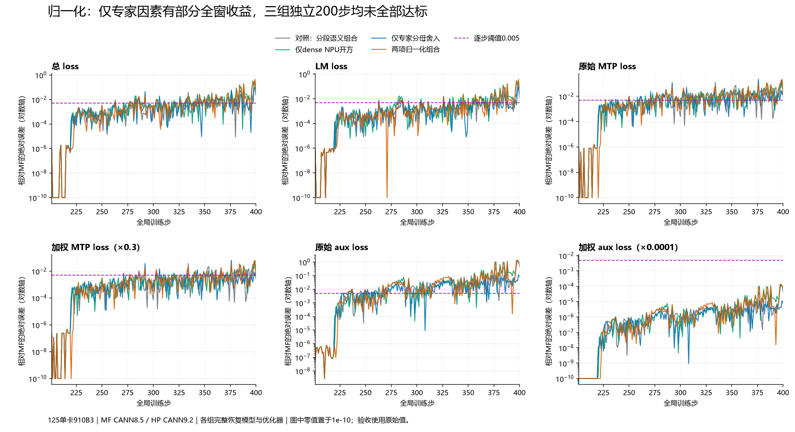

# 第219步：Muon归一化的两个首差及独立消融

> 持续定位记录。总问题：[中文总 issue #217](https://github.com/hf1s/hyper-parallel/issues/217)。本阶段三组独立完整200步均完成且未通过全部六项；累计87组独立完整实验仍未达标，另外3组参考值干预诊断不计验收。与217分段语义阶段连读，不能把本阶段组合结果解释成未经修改的库配置直接通过。

## 1. 目标、配置和前提

目标保持MF先训练200步，再由同一完整模型和优化器状态独立续训MF/HP至400步。比较total、LM、MTP原始值/加权值、aux原始值/加权值六项：首步≤0.001，同时记录更严格0.0005；全部200步逐步≤0.005。单卡、4K Arrow、Muon＋AdamW，数据和其他配置保持上一阶段一致。

实际设备是125上的Ascend910B3。MF使用用户压缩包内原始源码、MindSpore2.7.2、CANN8.5.0；HP使用CANN9.2.0-beta.2、torch/torch_npu2.12。HP的JT_dev于2026-10-16 04:42本地时间再次核实仍为`f637ef7ee4d4b416800716f1ebaaae7709b8a06a`；实验集成PR192，PR180已在JT_dev中。继续保留旧MF源文件不变，观测与兼容因素均在本任务独立脚本中。

当前比较基线是`hp-jtf637-packed217-both226`：在此前已声明的兼容因素上，包含绝对位置和全局MTP移位两项217分段语义因素。后者是复现旧MF行为的消融，不作为修改HP正确文档边界语义的建议。

## 2. 优化器恢复与更新边界已核对

`frontier219-state-comparison.json`要求两边观察任务的全部19步loss、分项、global norm、输入、RESTORE与原轨迹完全一致；同时校验配置、HP49份冻结源文件及因素调用次数。保存的实际权重还与独立全模型哈希实验链接，避免拿错步或错误布局。

| 观察边界 | dense-down `[5120,12288]` | expert gate-up `[8,3072,5120]` |
|---|---:|---:|
| 218步更新后权重 | 全部62914560元素精确 | 全部125829120元素精确 |
| 218步Muon动量 | 全部精确 | 全部精确 |
| 219步裁剪后梯度 | 全部精确 | 全部精确 |
| 219步更新后Muon动量 | 全部精确 | 全部精确 |
| 219步更新后FP32权重不同元素 | 20067773 | 7309846 |
| 219步BF16权重不同元素 | 138045 | 137977 |
| 权重最大绝对误差 | 6.224960088729858e-6 | 1.912936568260193e-5 |
| 权重平均绝对误差 | 2.0153653449530167e-8 | 2.3914188780215146e-8 |
| 权重相对L2误差 | 5.084733099878603e-6 | 7.024505732054701e-6 |

因此，这两项权重的首差不由其优化器状态漏恢复、裁剪梯度不同或动量更新不同引起。结论只覆盖已观测的两个完整权重和Muon槽，不外推到所有AdamW状态。

另有独立全梯度哈希实验：218步46/46裁剪前梯度精确；219步45/46精确，仅输出头梯度哈希不同。两项首差权重对应梯度均精确。输出头这一差异在219步未改变输出头权重，不能据此认为其对后续动量或训练没有影响。

## 3. 回放有效性：先证明复现原训练，再解释中间值

使用218步真实权重与动量、219步真实裁剪梯度，重新执行单次原优化器更新。HP两项完整权重和动量均逐位复现原HP训练；MF专家矩阵的原始实现和加观测实现也均逐位复现原MF训练。

**MF独立dense-down回放没有复现完整训练权重**，虽然它的原始/加观测回放互相相同且动量正确。本阶段明确排除这条回放作为dense训练内部边界的证据，并额外运行`mf-frontier219-ns-train`完整训练观测，核对所有48项模型哈希和每步loss/norm。失败回放的报告和退出码保留，不能将其混入有效实验。

## 4. 因素A：dense归一化开方位置

原兼容因素使用同一套9009×6984分块归约，最后把FP32平方和取到CPU上开方；替换因素只把该平方和的开方移到NPU，其余输入、归约树、epsilon、NS五轮矩阵计算和参数写回均保持一致。没有读取MF未来状态，也没有按训练步、参数坐标硬编码数值。

| 数值 | 原CPU开方 | NPU开方因素 |
|---|---:|---:|
| 归约后的FP32平方和 | 3.1080162525177 | 3.1080162525177 |
| 范数 | 1.7629567384719849 | 1.7629566192626953 |
| 加epsilon后的分母 | 1.7629568576812744 | 1.7629567384719849 |
| 与MF完整训练219步的整个权重逐位相等 | 否 | 是 |
| 与真实219步Muon动量逐位相等 | 是 | 是 |

真实输入使用FP64累加的平方和为3.1080159905800357，范数为1.762956604848808。NPU结果在这个输入上更接近此FP64范数：误差1.4413887416964144e-8，CPU为1.336231769677454e-7。但对**已经经过FP32归约的平方和**，其FP64平方根是1.7629566791381177；CPU舍入与NPU近似分别位于其两侧。不能将“这次NPU更接近真实输入”推广为“NPU sqrt总比CPU更正确”。这是兼容路径的运行位置及舍入差异，不足以指控CPU sqrt或CANN存在普遍错误。

完整训练dense观测已完成且19步指标、范数和每步48项模型FP32/BF16哈希均复现原MF轨迹。归一化前62914560个输入精确；原HP归一化后仅661个BF16元素不同，经过五轮NS后扩大为20068495个不同元素、最大误差0.0028076171875；NPU开方候选的归一化输入、归一化结果、NS完整输出均精确匹配MF。注意MF图模式导出的norm及denominator均为1.765625，这是物化后的BF16视图，不能冒充内部真实FP32分母。完整训练证据替代了未保真的独立dense回放。

## 5. 因素B：专家范数与epsilon之间的BF16舍入

专家gate-up按原模型规则拆成两个`[8,1536,5120]`逻辑矩阵。第一个矩阵的全部归一化输入和NS输出都精确；第二个矩阵的归一化输入精确，只有第2号专家（从0计数）的分母出现差异。

| 第二片第2号专家 | 数值 |
|---|---:|
| BF16输入的FP64范数 | 0.006332316201710827 |
| 相邻BF16值的中点 | 0.0063323974609375 |
| 原兼容路径：范数先舍入BF16，再加epsilon再舍入 | 0.006317138671875 |
| MF实际观测分母 | 0.00634765625 |
| 因素：FP32求范数并加epsilon，最后舍入BF16 | 0.00634765625 |

原精确范数略低于中点，加1e-7之后略高于中点，因此舍入时机足以改变1个BF16间隔。这与“MF的范数及epsilon沿计算路径保留较高精度、最后一起舍入”的解释一致；这里依据的是完整算术输出和单因素干预，不把源码中看见一个`norm()`直接等同于某个已审查的CANN融合内核。

基线该片共有6732234个归一化元素不同，最大绝对误差6.103515625e-5；经过NS五轮后7309931个元素不同，最大绝对误差0.01336669921875。只替换分母舍入顺序后，完整专家权重与MF的219步权重逐位一致，Muon动量也一致。

## 6. 正确性及业界对照

归一化具有明确的精度与epsilon契约，不能只用“更像旧MF”来判断谁正确。本阶段A、B都是当前归档兼容路径的可证伪因素；A尚不支持通用sqrt修复，B证明了提前BF16舍入可能丢失epsilon对结果的影响。

最新MF PyNative于本地04:42核实`5089da308ebcc146d0cbe32180c209c4f1d39d77`，其Muon文件SHA256仍为`9e9e5867a4225181a7014ca7809bae67d16e9bfa103a7316fb71aaa20a7fee7c`。`_normalize_newton_schulz_input`显式用FP32 Frobenius范数，用`clamp(norm,min=eps)`而不是旧图模式的`norm+eps`，归一化后转BF16。它不要求复刻旧图模式的分母舍入。

- [MF PyNative固定提交源文件](https://gitcode.com/mindspore/mindformers/blob/5089da308ebcc146d0cbe32180c209c4f1d39d77/mindformers/pynative/optimizer/muon.py)
- [Megatron固定提交的优化器集成](https://github.com/NVIDIA/Megatron-LM/blob/3914483fd325e053797aff3fa431d4a3141139aa/megatron/core/optimizer/emerging_optimizers.py)：Muon计算由Emerging Optimizers实现，不能只读兼容入口`muon.py`下结论。
- [NVIDIA Emerging Optimizers 0.4.0官方源码](https://docs.nvidia.com/nemo/emerging-optimizers/0.4.0/_modules/emerging_optimizers/orthogonalized_optimizers/muon_utils.html)：要求FP32输入，单卡默认使用`functional.normalize`，另支持FP64范数；并未要求旧MF的分块归约和BF16分母路径。

所以面向产品的改动需先定义归一化精度契约、量化完整窗口影响，再决定是否增加配置或修改默认行为。不能把本阶段全部兼容代码原样作为HP默认修复。

## 7. 独立消融与影响优先级

三组26步和三组完整200步均从同一step200完整状态独立启动：dense、expert、both；对照为packed217-both。每组单卡，设备、端口、日志及可变输出隔离。因素只处理当前实际值，没有teacher forcing、参考轨迹数值或步数/坐标特判。所有200步的输入、完整恢复、源码、配置及实际调用次数审计通过；前26步指标和范数与对应短实验逐值相同。新增实验编号85–87。

26步全模型哈希证明：只改dense消除219的dense权重首差，专家差异仍在；只改expert消除专家首差，dense差异仍在；两项组合使201–221每步全部48个FP32/BF16模型张量精确，222才出现两项QKV权重差异。三项短实验六指标均未超0.005，但这个短窗结论没有延续成200步通过。

下表每格为 **最大绝对误差 / 平均绝对误差 / 超0.005的步数**。首步六指标全部≤0.0005；200步逐步验收没有放宽，也未只看加权分项或总loss。

| 指标 | 217组合对照 | 仅dense开方 | 仅expert分母 | 两项组合 |
|---|---|---|---|---|
| 总loss | 0.324404716 / 0.00834080815 / 51 | 0.329409599 / 0.0122399724 / 66 | 0.112088203 / 0.00471795678 / 46 | 0.443288803 / 0.0119187117 / 66 |
| LM loss | 0.262339592 / 0.00604654431 / 37 | 0.302321911 / 0.00996494293 / 54 | 0.107800484 / 0.00303082466 / 27 | 0.378138542 / 0.0093571794 / 43 |
| 原始MTP | 0.207272371 / 0.0110177298 / 91 | 0.196392536 / 0.0113815218 / 100 | 0.21945556 / 0.00955850184 / 95 | 0.217510859 / 0.0123570671 / 99 |
| 加权MTP | 0.0621817112 / 0.00330531895 / 31 | 0.0589177608 / 0.00341445655 / 37 | 0.065836668 / 0.00286755055 / 31 | 0.0652532578 / 0.00370712012 / 35 |
| 原始aux | 1.33345173 / 0.0493444596 / 137 | 1.33453846 / 0.0826968355 / 126 | 0.122817748 / 0.018590258 / 130 | 1.35954418 / 0.0727807701 / 122 |
| 加权aux | 0.000133345173 / 4.93444596e-06 / 0 | 0.000133453846 / 8.26968355e-06 / 0 | 1.22817748e-05 / 1.8590258e-06 / 0 | 0.000135954418 / 7.27807701e-06 / 0 |

首次任一项超0.005分别为对照229、dense233、expert228、组合227。这个顺序和总loss收益顺序不同，因此不能只用首次超限步来排序。

| 优先级 | 发现及证据 | 当前处理与边界 |
|---|---|---|
| 高：有完整窗口收益 | 仅expert总loss max 0.324404716→0.112088203，均值0.008340808→0.004717957；原始aux max 1.333451726→0.122817748、均值0.049344460→0.018590258 | 优先研究归一化精度契约。但原始MTP max 0.207272371→0.219455560、超限步91→95；尚不能当作全指标修复。 |
| 高：下一首差的因果定位 | 组合后222主/MTP两项QKV只在Q片出现差异；完整状态排除及开方干预复现成立 | 继续独立Q开方消融，并同时在expert单项背景验证，避免只沿局部哈希精确但全窗退步的组合探索。 |
| 中：可复现但完整窗口负面 | 仅dense及组合分别将总loss均值增至0.012239972、0.011918712 | 保留负面结果及复现；不作为默认改动优先提交。组合仅用于推进因果边界。 |
| 低：暂无线性收益证据 | 219输出头梯度哈希差异当步未改变输出头权重 | 暂不追逐微小差异，若后续首差指向累积状态再回查。不能声称对全部未来训练无影响。 |

以上是本阶段新增因素的排序，不替代总issue中已确认的产品错误优先级。单因素贡献不能相加；表中组合的退步就是交互作用的实测证据。精确到某一步的参数，不等于整个训练更正确或长期误差更小。

## 7.1 第222步的下一处首差：完整状态与开方回放

HP两项组合与原MF重新运行201–222，均核验22步指标、范数、输入、恢复、源文件及模型哈希。221步完整权重和Muon动量精确，222步完整裁剪后梯度和更新后Muon动量仍精确。两项QKV的KV512行及RoPE64行精确，差异只在Q的1536行。

| 权重 | FP32不同元素 | BF16不同元素 | 最大绝对误差 |
|---|---:|---:|---:|
| 主模型第0层QKV | 4494975 | 38521 | 2.2724270820617676e-6 |
| MTP层QKV | 3825320 | 28921 | 2.620276063680649e-6 |

将真实221状态和222梯度传给原HP优化器，完整两项权重与动量逐位复现HP原训练；只把Q归一化相同FP32平方和的CPU开方移到NPU，两项完整权重与动量逐位匹配MF。主Q分母0.5353836417198181→0.5353837013244629；MTP Q分母0.007674096617847681→0.007674097083508968。其他算术和源数据不变。该证据是完整参数匹配，不是只比较某些坐标。

这仍是跨运行位置的兼容性结论，没有证明CPU sqrt错误。新的独立续训`qsqrt222-both/expert`分别在219组合背景与expert单项背景测试，结果另行审计；本发布版本不把运行中的实验算入87组或宣称通过。

## 8. 问题与PR的关系

总问题维护所有发现，包括必要产品修复、配置差异、旧MF语义、微小舍入差异和失败实验。已核实中文链路：#215→PR213，#187→PR192，#216→PR180；每个子问题和PR均反向关联总问题#217。本阶段尚无新增已确认必要的产品改动，不提交混合所有兼容因素的大PR。若完整验证支持产品修改，则每个问题建立独立中文子issue和单独PR，包含复现、正确性依据、影响及测试。

## 9. 存储与证据

原始大型张量只留在125任务目录，本地/公开分支仅保存小型日志、完整张量哈希、标量、配置和可复现脚本。MF217已完成的46份梯度文件中28份无损压缩、18份保留小文件；压缩前后完整字节SHA一致，净释放6496542720字节，已计入当时累计554604087036字节的清理/去重/无损归档回收量，不重复计数。219失败dense回放的三份大数组在成功完整训练观测替代后删除，净释放754987008物理字节，失败报告、退出码和源程序保留。24份有效回放数组已gzip无损归档，每份解压后的完整文件SHA核对后才移除原文件，另净释放2490105856物理字节；32份文件纳入收据，小标量文件保留。累计清理/去重/无损归档净回收557849179900字节。219/222仍需的实际状态与梯度保留。回放数组位置见`frontier219-replay-lossless-archive.json`，复跑旧分析前按映射解压并核验原文件SHA；dense FP64参考脚本已支持读取归档。

主要证据：

- `evidence/frontier219-state-comparison.json`
- `evidence/preclip219-hash-comparison.json`
- `evidence/frontier219-hp-muon-replay.json`
- `evidence/frontier219-mf-muon-replay.json`（含明确排除的dense回放）
- `evidence/frontier219-expert-ns-comparison.json`
- `evidence/frontier219-expert-denominator-replay.json`
- `evidence/frontier219-dense-npusqrt-replay.json`
- `evidence/frontier219-dense-fp64-truth.json`
- `evidence/frontier219-current-heads.json`
- `evidence/frontier219-issue-pr-link-audit.json`（公开版仅保留链接核验摘要，完整API响应私有保存）
- `evidence/frontier219-dense-ns-comparison.json`
- `evidence/norm219-independent26-audit.json`
- `evidence/norm219-independent200-audit.json`
- `evidence/frontier222-state-comparison.json`
- `evidence/frontier222-q-control-replay.json`
- `evidence/frontier222-q-npu-replay.json`
- `evidence/frontier219-source-manifest.json`、`frontier222-source-manifest.json`
- `evidence/frontier219-invalid-dense-replay-cleanup.json`、`frontier219-replay-lossless-archive.json`

复现顺序：按配置完整恢复step200；运行对应`launch_norm219_short.py`/`launch_norm219_full200.py`；执行`compare_norm219_short.py`/`compare_norm219_full200.py`核验保真和六项阈值。设备与路径需按环境映射。所有因素与原库修改边界由实际启动脚本及SHA清单记录。
