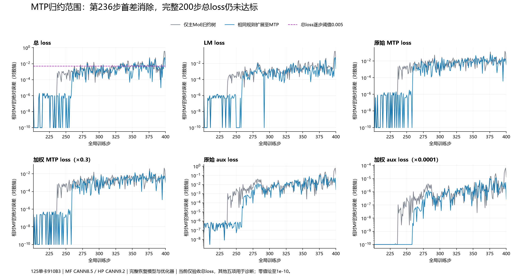

# 第236步MTP专家权重梯度：分块定位、单因素替换与完整窗口验证

关联[中文总问题#217](https://github.com/hf1s/hyper-parallel/issues/217)。当前只以总loss验收：第201步绝对误差≤0.001，201–400每一步≤0.005；MTP和Aux暂作定位指标。此记录区分局部因果、完整训练收益和产品正确性；第93组完整200步已审计，仍未达到总loss门槛。

## 实验配置与本轮唯一改动

- 125实际硬件Ascend910B3，所有训练运行各用一张卡；卡号、端口、工作目录和日志隔离，启动前核验空闲和真实文件系统余量。未使用129训练，未修改zth目录或停止其他用户任务。
- MF使用指定压缩包及MindSpore2.7.2/CANN8.5.0；HP使用JT_dev `f637ef7ee4d4b416800716f1ebaaae7709b8a06a`＋PR192集成`9213a97147020fb75e7a98a40f7e7b636f98d349`，已含PR180，PTA2.12/CANN9.2.0-beta.2。
- 使用库上4K Arrow、Muon＋AdamW、学习率1e-4、所有并行度1的当前配方。MF200模型与优化器状态完整恢复，沿用相同输入顺序；49份冻结依赖保持原SHA。
- 完整对照是第92组`hp-jtf637-global-sqrt400`。候选`hp-jtf637-weighted-mtp400`使用同一入口`capture_hp_global_sqrt400.py`，只把`P12_WEIGHTED_DVM_SCOPE=main`改为`both`。归约源文件`hp_weighted_dvm_factor.py`未修改；其余算法、舍入、恢复、数据和优化器因素均保持不变。
- 候选对每一步当前实际输入计算，不注入MF参考梯度、权重、步号特判或坐标特判。只读观察与完整200步分开运行，观察结果必须先通过轨迹保真审计。

## 从前向、反向、裁剪与更新四块缩小范围

前一轮在235完成全局开方兼容后，235全部46个裁剪前梯度与48个模型状态精确MF；236原对照有39/46个裁剪前梯度不同，更新后44项FP32、30项BF16模型不同。因此优先检查梯度生成，不能把传播到多项权重的差异分别算成优化器缺陷。

在236仅保存MF原生统计和完整覆盖哈希，HP保存对应边界哈希。按最终图的数据依赖匹配节点，避免将重计算复用的debug scope误认为实际模块归属。

|比较块|观察结果|本轮决定|
|---|---|---|
|归一化相关前向与反向边界|77个已映射边界全部相同，含16个norm输入域以及两处final norm的x、w、y、inverse RMS、dy、dx|在本步排除这些已检查边界；不扩大成“全部前向已证明相同”|
|MTP路由前向|router输入、权重、logits、sigmoid分数、归一化分数及所选专家系数精确MF|优先向反向追踪|
|所选专家系数的上游梯度|这是该路由链第一个已观测到的不同边界|在此之前检查专家加权求和的反向归约|
|后续路由反向|sigmoid梯度、router输入与权重梯度出现不同|先验证上游原因，不为传播结果逐项增加修复|
|全局裁剪与更新|原始输入梯度已不同|保留既有算法，先验证梯度首差消失后的结果|

对应审计：[77个边界](evidence/frontier236-boundary-statistics-comparison.json)、[MTP路由边界](evidence/frontier236-moe-statistics-comparison.json)、[原236梯度与模型](evidence/frontier236-native-statistics-comparison.json)。expert-major和token-major缓冲区未逆排列前不直接比较；填充token的shape差异不作为数值错误。

## 单因素先改到一致：36步独立复跑

短程`hp-jtf637-weighted-mtp236`从MF200完整恢复，只把已有归约作用范围扩展到MTP，执行201–236。输入、恢复、配置、源文件、49冻结依赖、其余因素及每步主/MTP调用次数审计全部通过。

|第236步观察|原对照|仅扩展到MTP|
|---|---:|---:|
|与MF相同的裁剪前梯度|7/46|46/46|
|与MF相同的逐参数平方和|11/46|46/46|
|完整梯度平方和|86.83460235595703|86.8332748413086（精确MF）|
|实际梯度范数|9.318509101867676|9.318437576293945（精确MF）|
|更新后FP32模型不同项|44/48|0/48|
|更新后BF16视图不同项|30/48|0/48|

235与236的全部模型、梯度、平方和及范数均精确MF。短程相对原对照的36步指标仅236梯度范数发生变化；该步loss在反向之前已经计算，仍为HP9.86388111114502、MF9.863880157470703。

这组受控替换证明MTP加权归约能解释本次分叉，**36步不能代替200步验收**。[完整短程审计](evidence/frontier236-weighted-mtp-short-audit.json)。

## 正确性与业界实现：同输入高精度比较

独立只读观察hp-jtf637-weighted-precision236完成36步，全部指标、范数、输入、恢复、49冻结来源、路由边界哈希以及既有因素均精确原对照。实际专家顺序逆排列后，含8个填充token的专家输出42,024,960个BF16值、上游梯度21,012,480个BF16值以及8,208个BF16系数，完整原生Dump哈希全部一致。独立FP32归约树产生的8,192个实际token系数梯度与MF原生Slice输出完整哈希相同。

在8,192个实际专家选择中，只有1个系数梯度不同，绝对差1.1641532182693481e-10；这个坐标上**原HP更接近FP64参考**。两侧整组最大绝对求和误差都为8.00423492819391e-7，没有声称整组或训练质量普遍更优。FP64参考先保留实际BF16乘积舍入，再以FP64求和，避免同时改变乘法和求和两个变量。

此计算仅在内存进行，释放临时数组后保留哈希和聚合误差，没有新保存全量数组。[同输入精度审计](evidence/frontier236-weighted-precision-audit.json)同时检查原始乘积输入与候选输出，防止把不同输入下的范数比较当作算子精度结论。

归约树沿用第212阶段已经验证的形式：BF16乘法不变，5120维拆为80行×64路，80行按半树并将奇数尾项加到首项，64路按相邻FP32相加，结果再转BF16。此实现针对旧图执行路径，不规定通用产品应采用固定隐藏维度或归约顺序。

[Megatron固定提交未融合unpermute](https://github.com/NVIDIA/Megatron-LM/blob/3914483fd325e053797aff3fa431d4a3141139aa/megatron/core/transformer/moe/moe_utils.py#L620)让概率类型参与乘法提升，归并后恢复输入dtype，没有规定旧MF的64路归约树。第212阶段同版本MF PyNative重放得到HP结果，旧MF图模式得到另一种舍入；这个历史结论适用于其已测输入，不冒充236新输入的PyNative实测。

因此先归类为旧MF图数值兼容实验。是否存在值得改变默认行为的产品错误，需要独立的语义、精度或完整训练收益证据；已有产品问题仍关联各自中文子issue和PR，不能将每个ULP差异都提交为通用修复。

## 完整200步与下一次分界观察

第93组独立201–400退出码0；全部200份输入、完整恢复、49冻结来源、其余因素和实际调用审计通过，前36步逐值复现独立短程。**总loss仍未通过：首步9.5367431640625e-7，最大0.059581756591796875，平均0.0030120646953582762，31步超过0.005；最后一步0.0033330917358398438不能代表全窗。** 独立完整计数92→93，另3组完整参考值干预继续排除。

|指标|原对照最大／平均／超0.005步数|仅扩展MTP最大／平均／超0.005步数|
|---|---:|---:|
|总loss（当前验收项）|0.355926513672／0.0074562394619／46|0.0595817565918／0.00301206469536／31|
|LM|0.330811500549／0.00602202653885／31|0.0558061599731／0.00190888643265／16|
|加权MTP|0.0441029071808／0.00250853031874／28|0.0192716121674／0.00179810613394／20|
|原始MTP|0.147009690603／0.00836176772912／89|0.0642387072245／0.00599368711313／78|
|加权Aux|6.27065464854e-05／2.07342879823e-06／0|1.12828658894e-05／1.08430823591e-06／0|
|原始Aux|0.627065464854／0.0207342879823／100|0.112828658894／0.0108430823591／88|

相对受控背景，总loss最大误差下降83.26%，平均误差下降59.60%，超差步数46→31，首次超差272→282。六项最大和平均误差均下降；MTP/Aux表中步数仅作诊断，不是当前额外验收条件。

[完整200步审计](evidence/frontier236-weighted-mtp-independent200-audit.json)提供全部逐步误差及保真检查。局部改动虽有完整窗口收益，仍不能宣称对齐完成。

**258/259分界观察已完成且保真通过。** 258全部46组裁剪前梯度、逐参数平方和、总平方和与范数精确；更新后48项模型中仅主干model.layers.1.self_attn.q_b_proj.weight的FP32和BF16视图不同。259全部46组梯度已不同，更新后46项FP32、31项BF16模型不同。故优先级转到258附近该Q-up的Muon更新，259大面积梯度差属于后续传播，不能拆为46个独立问题。

下一组只观察257/258的完整模型，并保留这个Q-up的权重、Muon动量和258裁剪后梯度，验证模型输入和优化器内部状态；若257已不同，再回到236–257区间缩小首次分叉。不会仅凭范数相等断言模型相等。[258/259原生统计与模型审计](evidence/frontier259-native-statistics-comparison.json)。

## 历史负面结果与当前优先级

第80/81组在当时的旧背景上，main与both完整200步逐值一致，故当时MTP扩展没有增量效果。现在packed语义、CE、Muon epsilon与全局开方等背景已经变化，236实际输入也变化；本轮观察到MTP扩展能消除首差。两项证据不矛盾，报告保留背景条件，避免把因素影响视为与训练轨迹无关的常量。

|优先级|事项|处理依据|
|---|---|---|
|验收最高|完整200步总loss|以每步误差为准；局部哈希一致不能代替|
|当前定位首位|258附近主干第1层Q-up的Muon更新|258梯度精确但单一权重不同，259多项差异属后续传播|
|已确认局部因果及完整窗口收益|MTP专家权重梯度归约范围|最大/平均总loss误差下降83.26%/59.60%，仍31步超差|
|当前步降级|77个已检查norm边界、路由前向|本次完整哈希相同，不盲改相应算子|
|不新增产品缺陷|旧背景MTP无增量、dtype边界/排列造成的表观差异|保留阴性结果与比较条件|

## Dump成本、存储与复现

- MF首次广域236统计约2.42MB，只取一个迭代；后续梯度边界仅48个算子输出，每步约20KB。保留最终图以核对节点，未保存梯度数组。
- 大张量使用安装MS2.7.2实际的20480元素分块SHA1组合协议，覆盖全部元素；不以有限小数位的min/max/L2或普通整数组SHA1冒充原生精确比较。
- 只读精度计算在内存完成后释放临时数组，输出只有哈希及聚合误差。未因“需要更精确”直接开启全图tensor dump。
- 125启动时STATE约38.76GB、home约74.04GB空闲，属于不同文件系统；本阶段工作路径仍分别是`/dev/shm/jt-adamw-align-20261013/state/jt-recipe-20261014`和`/home/xxl/jt-adamw-align-20261013/phase12`。
- 早期236边界探针误启用冗余201–226模型哈希；仅停止核验归属后的本任务启动进程，9步已产出指标精确对照。该观察开关关闭后独立重跑完成36步，不作为数值失败或完整实验计数。保留[终止记录](evidence/frontier236-redundant-model-hash-stop.json)和[前缀保真](evidence/frontier236-redundant-model-hash-prefix-audit.json)。

复现入口：先按[源清单](evidence/frontier236-source-manifest.json)部署新增文件、保持49基础源SHA与step200完整恢复产物，再执行`launch_weighted_mtp236_full200.py`。待退出码0后执行`compare_weighted_mtp236_full200.py`；同输入精度观察用`launch_weighted236_precision.py`与`compare_weighted236_precision.py`。各launcher遇到已有目的地拒绝覆盖。
