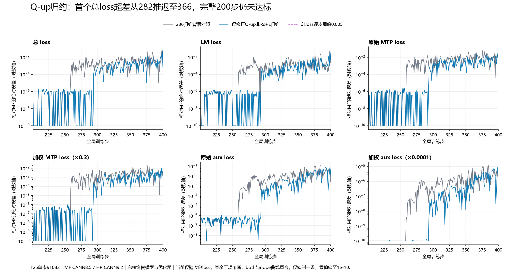

# 第258步Q-up归约：因果替换、七组留出验证与两组完整200步消融

本阶段完成第94、95组独立200步实验，仍未满足当前总loss验收。只改变Q-up非RoPE分块的实时平方和归约，消除了258/259的完整模型和梯度分叉；全窗平均误差下降52.43%，超限步数31→13，首次超限282→366，但最大误差仍为0.05675220489501953。额外改变RoPE分块没有本轮可测增量收益，下一轮保留较小改动。

当前门槛为第201步总loss绝对误差≤0.001，第201–400每一步≤0.005。达标后停下与用户交互；MTP/Aux只作诊断，不另开专项。旧门槛、历史配方及短窗口结果均不混算。本阶段前的完整[236阶段记录](阶段记录-236MTP加权归约与分块消融.md)和[235原文归档](总问题-235阶段原文归档.md)继续保留。

## 1. 环境和不变项

125单卡Ascend910B3。HP采用JT_dev f637ef7ee4d4b416800716f1ebaaae7709b8a06a，集成PR192的实验提交9213a97147020fb75e7a98a40f7e7b636f98d349，已含PR180；CANN9.2.0-beta.2。MF保持原压缩包，MindSpore2.7.2/CANN8.5.0，未改归档源码。本轮沿用库上单卡4K Arrow配方及已明确的Muon＋AdamW组合，完整恢复MF200模型、28份Muon动量、18＋18份AdamW矩和训练步数。

两组独立训练均从MF200离线状态开始，运行201–400；没有从258参考值接着训练，没有注入MF平方和、梯度、权重或某步专用数值。200份批次逐元素审计、完整恢复、49份冻结来源、既有算术因素及调用范围均通过。第94组前59步完整指标精确复现另一张卡上的短程观测。

关键配置与启动记录：

- [仅非RoPE配置](configs/hp-jtf637-qup-nope400.yaml)、[启动脚本](launchers/run-hp-jtf637-qup-nope400.sh)、[启动回执](evidence/hp-jtf637-qup-nope400-launch.json)：卡6，端口31663。
- [两个分块配置](configs/hp-jtf637-qup-both400.yaml)、[启动脚本](launchers/run-hp-jtf637-qup-both400.sh)、[启动回执](evidence/hp-jtf637-qup-both400-launch.json)：卡4，端口31664。
- 短程卡7、端口31665；MF/HP隔离单参数重放使用不同空闲卡。所有实验仍为单卡；并行只用于独立实验。
- [34份本阶段来源清单](evidence/frontier258-source-manifest.json)：本地与实际执行文件SHA256一致，AST检查通过。部分本地换行已按远端执行字节统一，未改变远端已执行源码。

本阶段95组内的完整测量固定在f637ef7ee4d4b416800716f1ebaaae7709b8a06a＋PR192。之后复核发现JT_dev合入e21302f9e7b47d41b61f5f4987fc34c000f7c978（PR230），仅修改FSDP重算wrapper识别及对应单测。已在独立目录合并为181fab5f5c31ceeb2e385c1267aa586d5c6c8835，1947源码校验与59项单测通过；第96组同配置200步已完成，[新版本完整审计](evidence/jt-e213-independent200-audit.json)全部通过，200步指标和范数逐字节等同第94组。输入、恢复、49冻结来源、所有既有因素与1947个当前源码均核验；只有两处预期源码变化。入口脚本仅CRLF改为LF，首轮严格原始字节审计因此拒绝，保留失败日志后核对逐字节换行归一化等价，再完成审计；未改运行结果。总loss仍有13步超限，现累计96组独立完整200步未通过。

## 2. 按边界缩小问题，而不是混改所有差异

[258/259原生统计](evidence/frontier259-native-statistics-comparison.json)先证明：258的46份原始梯度、46个平方和、全局平方和及范数精确，只有主干第1层Q-up更新后的权重不同；259才扩散为46份梯度不同。因此后者是传播表现，不能拆成46个独立问题。

选定参数：

- HP：model.layers.1.self_attn.q_b_proj.weight。
- MF：decoder.layers.1.self_attention.linear_q_up_proj.weight。
- 完整形状24576×1536，共37,748,736个FP32元素；按128个头拆为非RoPE的16384×1536和RoPE的8192×1536，NS归一化前分别转置。

[完整状态审计](evidence/frontier258-state-comparison.json)确认257所有48个模型张量精确；目标参数的257权重、257动量、258裁剪后梯度、258更新后动量全部逐元素精确。258权重出现14,339,971个FP32差异和97,093个BF16差异，最大FP32绝对差4.861503839492798e-6。排查范围因此缩到动量形成之后的NS与权重更新。

[两侧原始Muon重放](evidence/frontier258-muon-boundaries.json)各自精确复现实际训练的完整权重与动量。非RoPE分块pre_norm的25,165,824个元素精确，归一化后237,217个BF16表示值不同，五轮NS后14,340,187个值不同、最大差0.002685546875。RoPE分块的完整pre_norm、normalized与NS输出均一致。这是可重放的首个已测分界。

## 3. 用原生Dump证明平方和的因果作用

对原MF更新图只选择两个Sqrt/Add/Div/Cast归一化融合算子，iteration0，原生Dump共6个输入输出，约302MB。没有插入源码TensorDump；Dump开启后的完整权重与动量仍精确复现训练。之后只开统计值和编译文本验证，不持续保存大数组。

[原生Dump审计](evidence/frontier258-builtin-boundaries.json)和[原生DVM文本](evidence/frontier258-builtin-native-dvm-0.txt)显示：

| 分块 | MF平方和FP32 | FP32位模式 | HP普通square.sum重放位模式 |
|---|---:|---:|---:|
| 非RoPE | 2.532902726670727e-5 | 936671660 | 936671656 |
| RoPE | 0.00015634222654625773 | 958656460 | 958656461 |

HP norm内部的平方和未直接Dump，表格右列来自同输入的普通square.sum重放，不冒称实际norm内部值。实际范数和分母已直接观测。

两个非RoPE分母分别约0.005032895132899284和0.005032894667237997。先做明确标记为诊断的参考值替换：仅替换MF原生平方和，HP执行开方、加同一epsilon、除法与BF16转换后，237,217个归一化差异全部消失。该参考标量只用于隔离因果，未用于独立训练。

随后从当前输入独立计算：9776元素一块，611行×16通道，行半树及奇数尾部合并、通道相邻归约、40个向量核交错累加、核结果依次合并，FP32设备开方。无保存的参考数值、步数特判或坐标特判。

[平方和替换与独立重算](evidence/frontier258-square-sum-screen.json)中，两分块独立平方和均与MF原生标量位模式一致。[完整参数重放](evidence/frontier258-hp-q-up-replay.json)只启用非RoPE因子后，258完整37,748,736个FP32权重与MF精确；动量也精确。

未采纳的表达式保留在[归一化阴性筛选](evidence/frontier258-norm-expression-screen.json)：普通FP32范数、FP64范数转FP32、普通square.sum.sqrt以及除法/倒数乘法均未消除非RoPE差异；把范数/分母直接压成BF16反而产生1,981,752个差异。额外observer看到的BF16标量不代表融合内部实际FP32值。

## 4. 七组输入验证，避免单样本碰巧吻合

[完整留出审计](evidence/frontier258-norm-holdout-audit.json)覆盖258和229的两个真实分块，以及窄/宽指数范围的三组合成输入。四组非RoPE各25,165,824元素、三组RoPE各12,582,912元素，共138,412,032个输入元素。

每组均核对完整原生BF16输入哈希、完整归一化输出哈希、FP32平方和原始字节SHA1；全部一致。MF小重放的归约DVM指令与真实原生更新的对应指令一致，仅规范化图内op编号。增加hash统计后输出与未加hash的重放一致。全程只保存哈希/统计/编译文本，不保存这七组全量数组。

这证明七组输入的标量及完整输出等价，没有声称读取了DVM内部所有tile partial。输入构造、MF/HP重放和对照脚本均在来源清单中。

## 5. 独立59步重新走完整训练

[短程审计](evidence/frontier258-q-up-native-statistics-comparison.json)确认额外观察未改变候选轨迹；200步候选与短程前59步精确一致，完整批次和恢复精确。

| 边界 | 258 | 259 |
|---|---:|---:|
| 裁剪前梯度精确 | 46/46 | 46/46 |
| 参数平方和精确 | 46/46 | 46/46 |
| 全局平方和、范数精确 | 是 | 是 |
| 更新后FP32模型精确 | 48/48 | 48/48 |
| 更新后BF16表示精确 | 48/48 | 48/48 |

这同时消除了原258权重首差和259传播差异；不是只比较一个loss打印值。

## 6. 两组完整200步：有效，但仍失败

| 总loss指标 | 第93组背景对照 | 第94组仅非RoPE | 第95组两个分块 |
|---|---:|---:|---:|
| 首步绝对误差 | 9.5367431640625e-7 | 同左 | 同左 |
| 最大绝对误差 | 0.059581756591796875 | 0.05675220489501953 | 同左 |
| 最大误差步 | 399 | 399 | 399 |
| 平均绝对误差 | 0.0030120646953582762 | 0.001432727575302124 | 同左 |
| 超0.005步数 | 31 | 13 | 13 |
| 首次超限步 | 282 | 366 | 366 |
| 最后一步误差 | 0.0033330917358398438 | 0.00045490264892578125 | 同左 |
| 总loss验收 | 不通过 | 不通过 | 不通过 |

[仅非RoPE完整审计](evidence/frontier258-q-up-nope-independent200-audit.json)、[两个分块完整审计](evidence/frontier258-q-up-both-independent200-audit.json)。最大误差下降4.75%、均值下降52.43%。超限步为366、369、373、376、380、381、385、386、392、396、397、398、399。

第94/95组200步所有标量指标及梯度范数记录逐字节一致，输入和恢复也通过审计。仅凭这些指标不声称每步全部内部状态精确；能确认本背景下额外RoPE因子没有可测收益，因此下一轮只保留非RoPE改动。两组均是独立训练，不把留出试验或参考值替换算作完整验收。

图中MTP/Aux是诊断数据，只有总loss画当前0.005门槛。MTP原值与加权值、Aux原值与加权值分别呈现，不以加权数值较小冒充原值对齐。

## 7. 哪个更正确，为什么本阶段不修改产品默认实现

[同公式FP64精度审计](evidence/frontier258-normalization-precision.json)使用相同BF16表示输入和实际归档epsilon，在FP64计算平方和、开方、加epsilon和除法：

- 非RoPE的237,217个不同归一化值全部是MF更近，HP更近0个、相同距离0个。
- 全张量平均绝对误差HP为2.0538466100203685e-7，MF为2.0538463077742996e-7，改善约3.02e-14；两者最大绝对误差同为8.527014731420438e-6。
- HP普通square.sum重放与原范数更接近FP64标量，但BF16归一化结果反而是MF更近。不能只按中间标量误差排序，也不能把最终更接近当成整个框架或CANN版本更正确。
- 五轮NS及后续训练能放大这些边界舍入差异；“单值差很小”不能替代实测全窗消融。

[现代MF PyNative固定源码](https://gitcode.com/mindspore/mindformers/blob/d3f5dc943f6bf50cfa238db9c320ba4ff75ac52e/mindformers/pynative/optimizer/muon.py)在归一化处使用FP32 Frobenius范数、clamp，再转BF16。该快照已保存并核验；本轮GitCode网页重开失败，没有宣称再次在线取到更新提交。

[Megatron的Muon兼容入口](https://github.com/NVIDIA/Megatron-LM/blob/915b1d2d427e526dabc4a0b460562c257376025c/megatron/core/optimizer/muon.py)转到Emerging Optimizers；[NVIDIA官方实现](https://docs.nvidia.com/nemo/emerging-optimizers/0.4.0/_modules/emerging_optimizers/orthogonalized_optimizers/muon_utils.html)使用FP32归一化，可选FP64范数，分布式平方和归约后开方。它们不要求复刻旧MF特定9776元素分块及40核合并顺序。当前因素归类为旧编译路径兼容实验，有固定形状约束和CPU端partial合并，不应直接替换通用高性能默认实现。

已有必要产品修复继续分别关联中文子issue与PR，见总issue217的索引。本阶段未证明新的通用数学契约错误，因此不提交把本地兼容/观测因素混进产品默认的PR。

## 8. 当前影响优先级与下一步

| 优先次序 | 项目 | 证据与处理 |
|---|---|---|
| 1 | 第293步第0层MLP gate的Muon更新 | 原生统计保真通过：293全部46梯度、平方和及范数一致，更新后只有gate_proj权重不同；294才扩散到46梯度。优先检查这次更新的状态、归一化和NS。 |
| 2 | Q-up非RoPE归约 | 已有完整参数替换、七组留出、短程完整状态和200步收益；作为下一轮背景保留。收益是条件性的，不保证与其他因素线性相加。 |
| 3 | 额外RoPE归约 | 两组完整窗口标量完全一致，当前无增量收益；不纳入下一轮背景。 |
| 4 | 普通BF16分母/范数表达式猜测 | 已被重放否定或恶化；停止继续盲目组合。 |
| 5 | 259传播出来的46梯度差 | 已随258单参数修正消失，不拆为额外问题。 |

[293/294原生统计审计](evidence/frontier294-native-statistics-comparison.json)已完成。293全局范数11.4267578125、平方和130.57080078125精确；294范数HP14.029990196228027、MF14.029330253601074。该组只保留统计和哈希，没有全量梯度。

后续只采集292/293对应gate/up的必要状态和293裁剪后梯度。原MF packed fc1使用交错行布局，gate为偶数行、up为奇数行，依据归档模型的alt_pair_periodic规则，不能误按上下两半切分。HP观测首次因安装顺序失败，修正后的第二次在202遇到显存不足；失败日志均保留，第三次保持算术和配置不变换空闲卡后完成，状态、输入和指标保真通过。292所有48模型精确；125829120个裁剪后梯度及gate/up前后动量精确，293仅gate权重有28668749个FP32、143935个BF16差异。MF独立重放仅采集两个归一化融合算子的hash/statistic与DVM文本，完整原生更新精确复现实际训练。

HP原始重放也精确复现自身训练；两个完整pre_norm哈希与MF一致，首个已测差异在gate归一化。独立复刻本形状的9776元素归约后，两分块平方和与完整归一化输出原生哈希精确；完整gate/up参数更新均精确MF，未注入参考值。该候选已在新JT_dev上启动独立200步和293/294观测，尚不计入通过或完整实验数量。仍以总loss全窗口通过为结束条件。

## 9. 存储和复现

本阶段约302MB原生全量Dump只用于直接验证融合边界。完成重放后，[清理4个重复数组](evidence/frontier258-builtin-array-cleanup.json)，释放301,990,400字节；保留两个原生标量、完整原文件/值哈希、图、DVM和可再生输入。

另对任务自有且无人使用、完整NPY字节一致的三对权重/动量文件做[原子硬链接去重](evidence/frontier258-state-dedup-cleanup.json)，节省452,985,216逻辑字节，原路径和内容不变。NPY头或完整文件字节不同的5对文件保留。本阶段合计节省754,975,616逻辑字节，不重复计入历史；没有清理zth、xxl2或共享文件。

实际保留位置为125的/home/xxl/jt-adamw-align-20261013/phase12和/dev/shm/jt-adamw-align-20261013/state/jt-recipe-20261014。大文件未传到本地公开证据，公开包仅含脚本、配置、启动命令、日志、统计、哈希与图表。后续再次产生大型文件前继续核验实际挂载文件系统余量。

重放入口：replay_hp_frontier258_muon.py、replay_mf_frontier258_muon.py、replay_mf_frontier258_builtin_dump.py、replay_hp_frontier258_q_up.py；独立训练入口capture_hp_q_up258.py，唯一新增算术因子hp_q_up258_factor.py。新运行必须使用新run/output目录；已有启动器拒绝覆盖旧记录。
