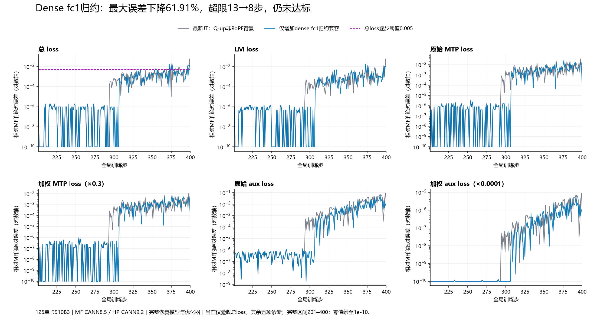

# 第293步 dense fc1 归一化：因果定位、独立消融与306步新边界

第97组独立完整200步仍未通过总loss门槛。在最新JT_dev背景上，只增加dense fc1形状的实时归约兼容，最大误差0.05675220489501953→0.021615982055664062，均值0.001432727575302124→0.001157287359237671，超限13→8步。原293/294完整梯度与模型分叉已消失；新的已测分叉出现在306优化器更新后，第0层Q-up参数首先不同。

正确性结论需要单独说明：293的474042个不同归一化表示值，原HP均比旧MF更接近同公式FP64参考。因此本项是匹配归档MF编译行为的兼容实验，不能认定HP算法错误，也不能按本轮旧MF匹配结果直接修改产品默认实现。

## 1. 固定配置、恢复和验收

HP上游为JT_dev e21302f9e7b47d41b61f5f4987fc34c000f7c978，已包含PR180、PR230；实验集成PR192后提交181fab5f5c31ceeb2e385c1267aa586d5c6c8835。1947个实际源码文件与运行导入目录已核验，相关59项测试通过。HP CANN9.2.0-beta.2；MF继续使用原压缩包，MindSpore2.7.2/CANN8.5.0，未改归档源码。设备为125的910B3，所有训练仍为单卡，数据为4K Arrow。

沿用当前库单卡配方Muon＋AdamW，从MF200完整恢复模型、28份Muon动量、18份AdamW一阶矩、18份二阶矩与训练步数。Muon目标参数的lr=1e-4、weight_decay=0.1、momentum=0.95、nesterov=True、5轮NS及其既有算术因素均不变。

当前仅验收总loss：201首步绝对误差≤0.001，201–400每一步≤0.005；达标后停下交互。MTP和Aux只记录诊断值，原值和加权值分开。短程、孤立重放、教师值替换均不计作独立200步验收。

- [第97组配置](configs/hp-jte213-fc1norm400.yaml)、[启动脚本](launchers/run-hp-jte213-fc1norm400.sh)、[启动回执](evidence/hp-jte213-fc1norm400-launch.json)：卡7、端口31675。
- [完整200步审计](evidence/frontier293-fc1-independent200-audit.json)：200份输入、完整恢复、49份冻结来源、当前源码身份、全部既有因素、调用范围均通过。
- [原最新版本背景复核](evidence/jt-e213-independent200-audit.json)的200步指标与旧版本第94组逐字节一致；版本更新本身没有改变本任务轨迹。

## 2. 先缩到更新，再缩到归一化

[293/294原生统计](evidence/frontier294-native-statistics-comparison.json)证明293全部46组裁剪前梯度、46个平方和、全局平方和和范数一致，更新后只有第0层MLP gate权重不同。294的46组梯度差异是之后传播出来的表现，不应拆成46个独立问题。

目标HP参数为model.layers.0.mlp.gate_proj.weight及其配对up_proj，形状各12288×5120。MF参数decoder.layers.0.mlp.linear_fc1.weight为24576×5120的交错行布局，偶数行为gate、奇数行为up；依据原模型alt_pair_periodic规则，不能按上下半块切分。

[完整状态审计](evidence/frontier293-state-comparison.json)结果：

| 观察边界 | 结果 |
|---|---|
| 292更新后所有48模型张量 | FP32及BF16表示均精确 |
| 292 gate/up权重与Muon动量 | 每块62914560元素均精确 |
| 293裁剪后packed梯度 | 125829120个FP32元素精确 |
| 293更新后gate/up动量 | 两块均精确 |
| 293更新后up权重 | 全部精确 |
| 293更新后gate权重 | 28668749个FP32差异，143935个BF16差异；最大绝对差7.442431524395943e-6 |

两侧原始单参数更新都精确重现实际训练的完整权重和动量。MF重放直接调用原归档_apply_muon_update，仅选择两个原生归一化融合算子开启统计/hash与DVM编译文本；不插入源码TensorDump，不保存新的完整算子数组。HP重放同样没有写全量中间值。

完整pre_norm哈希在两侧一致，gate的归一化输出开始不同，up归一化表示原本已一致。证据：[MF原生重放](evidence/frontier293-mf-builtin-stat.json)、[HP原始重放](evidence/frontier293-hp-muon-replay.json)、[原生统计CSV](evidence/frontier293-native-normalization-stat.csv)。

## 3. 用实际输入重算，验证单点替换

采用此前从原生DVM识别的9776元素分块：611行×16通道、行半树与奇数尾部合并、通道相邻归约、40核交错累加与依次合并，最后使用NPU FP32开方及归档epsilon。dense fc1转置后共有6436块，尾块6000元素。本因素只处理12288×5120形状；不读取MF参考平方和，不识别步数。

| 分块 | 独立计算平方和FP32 | 独立范数FP32 | 加epsilon后分母FP32 |
|---|---:|---:|---:|
| gate | 0.5588365197181702 | 0.7475537061691284 | 0.747553825378418 |
| up | 0.5484104156494141 | 0.7405473589897156 | 0.7405474781990051 |

原HP gate范数0.7475537657737732、分母0.7475538849830627；原HP up范数0.7405474185943604、分母0.7405475378036499。up的中间标量虽然不同，本次BF16归一化输出仍精确相同，不能据标量不同就单列影响。

两块独立平方和的原始字节SHA1、完整归一化输出原生SHA1均精确匹配MF。[完整更新重放](evidence/frontier293-hp-fc1-replay.json)进一步证明gate/up完整权重和动量均精确MF。比较参考值发生在结果算完以后，没有向更新路径注入参考值。

三组额外留出输入覆盖窄指数、宽指数和只激活6000元素尾块的情形，总计188743680个输入元素。[留出审计](evidence/frontier293-norm-holdout-audit.json)核验完整输入、输出、平方和字节、原生BF16输入哈希及DVM归约指令，全部通过；只保存统计、哈希和编译文本。

## 4. 短程与完整训练必须分别验证

独立短程从MF200重新运行至294。[短程审计](evidence/frontier293-fc1-native-statistics-comparison.json)确认293和294均为：

- 46/46裁剪前梯度、46/46参数平方和精确；
- 全局平方和、范数精确；
- 更新后48/48 FP32模型及48/48 BF16表示精确；
- 短程94步指标、输入、恢复与独立200步候选前94步一致。

| 总loss指标 | 第96组背景 | 第97组仅增加fc1归约 |
|---|---:|---:|
| 首步绝对误差 | 9.5367431640625e-7 | 9.5367431640625e-7 |
| 最大绝对误差 | 0.05675220489501953 | 0.021615982055664062 |
| 最大误差步 | 399 | 376 |
| 平均绝对误差 | 0.001432727575302124 | 0.001157287359237671 |
| 超0.005步数 | 13 | 8 |
| 首次超限步 | 366 | 335 |
| 最后一步误差 | 0.00045490264892578125 | 0.009406089782714844 |
| 验收 | 不通过 | 不通过 |

最大误差下降61.91%，平均误差下降19.22%。但首次超限反而提前，最后一步变差，必须一起披露；不能把某个局部指标改善说成轨迹处处改善。第97组超限步为335、355、373、376、396、398、399、400。

诊断分量最大误差：LM 0.017912864685058594；加权MTP 0.0074024200439453125、原始MTP 0.024674733479817412；加权Aux 6.003269646316753e-6、原始Aux 0.06003269646316767。只有总loss决定当前验收。

## 5. 哪个更接近正确公式

[FP64精度重放](evidence/frontier293-normalization-precision.json)保持相同BF16表示输入和实际归档epsilon，在FP64评估平方和、开方、加epsilon及除法，再比较两侧实际BF16表示值的距离。

gate有474042个不同值：HP更近474042个，MF更近0个，等距0个。全张量平均绝对误差HP=1.1616212184502641e-7，MF=1.1616212889246427e-7，差约7.05e-15；最大误差两者同为1.2782208762533546e-5。up没有不同的最终表示值。

本结论与258处“MF表示更近”方向相反，说明归约顺序不能给整个框架或CANN版本贴上统一的正确/错误标签。微小表示差可能经NS和训练放大，但“更贴近旧MF”也不等于“更贴近数学参考”。

现代MF PyNative的[固定源码](https://gitcode.com/mindspore/mindformers/blob/d3f5dc943f6bf50cfa238db9c320ba4ff75ac52e/mindformers/pynative/optimizer/muon.py)使用FP32 Frobenius范数及clamp后转BF16。[Megatron固定入口](https://github.com/NVIDIA/Megatron-LM/blob/915b1d2d427e526dabc4a0b460562c257376025c/megatron/core/optimizer/muon.py)转到Emerging Optimizers；[NVIDIA官方实现](https://docs.nvidia.com/nemo/emerging-optimizers/0.4.0/_modules/emerging_optimizers/orthogonalized_optimizers/muon_utils.html)使用FP32归一化、可选FP64范数，并支持分布式平方和归约。它们不约定旧MF的特定分块顺序。

因此本轮固定形状、CPU partial合并的原型只用于因果实验和归档兼容，不直接提交成通用默认实现。已有必要产品修复仍分别关联独立中文子issue/PR：215→213、187→192、216→180。

## 6. 新边界与影响排序

[306/307原生统计审计](evidence/frontier307-native-statistics-comparison.json)已完整通过保真检查：306全部46组梯度、平方和、全局范数精确，范数16.19000816345215、平方和262.11639404296875；更新后仅model.layers.0.self_attn.q_b_proj.weight不同。307才出现46组梯度差异，范数HP=12.938406944274902、MF=12.937731742858887。

| 当前优先次序 | 项目 | 处理依据 |
|---|---|---|
| 1 | 306第0层Q-up优化器更新 | 新的首个已测参数分叉；采集305/306状态与306梯度，继续拆RoPE/非RoPE。 |
| 2 | dense fc1归约兼容 | 已有完整参数因果、三组留出、短程全模型和200步收益；保留作下一轮背景，但注明HP精度参考更好。 |
| 3 | Q-up额外RoPE归约 | 旧背景第94/95组无标量增益；新fc1背景出现Q-up分叉，因此只做条件性复测，不推翻旧阴性结果。 |
| 4 | up中间范数差 | 本次归一化表示与最终更新精确，没有独立影响证据；不另加修复。 |
| 5 | 294与307传播后的多处梯度差 | 随上游更新传播，不能重复计成多个根因。 |

第98组RoPE增量消融、配对短程及306状态观察现已完成，详见[306阶段记录](阶段记录-306QupRoPE条件消融与330边界.md)：总loss仍有3步超限。只修改一个因素的效应依赖当前背景，不能把各阶段百分比相加。

## 7. 存储、失败记录与复现

293状态观察首次因安装顺序导致保护检查失败；修正后一次在202遇显存不足，第三次保持算术不变换空闲卡完成。原日志、来源与失败状态保留，失败运行不计入完整200步。306下一批启动前遇sjq占满8卡，资源检查阻止启动；卡释放后才运行，没有停止他人进程。306状态组的全模型哈希探针窗口range(305,259)为空，未触发；保留原源和失败日志，选定305/306原始状态完整，改用独立306原生观测的目标模型哈希交叉核验，不声称观察过305的所有模型张量。

原生Dump优先使用统计/hash，只有定位需要才采选定完整值。当前保留293的必要状态用于重放，306只准备目标Q-up状态与单步梯度，没有保存全部网络激活。

已清理本地与125各一份已解包验证的源码压缩包，共16891610字节；保留Git提交、1947文件清单和运行来源。另清理已不用的teacher357参考检查点129个数组，释放27972650896逻辑字节；保留原模型/优化器清单、STATE、配置、日志、各文件SHA256及清理回执。MF200模型和优化器检查点保留，验收不依赖teacher357。

执行与证据目录仍为125的/home/xxl/jt-adamw-align-20261013/phase12和/dev/shm/jt-adamw-align-20261013/state/jt-recipe-20261014。本地交付仅同步小证据与可编辑脚本。后续生成大文件前核验对应挂载空间；所有清理仅涉及本任务产物。
