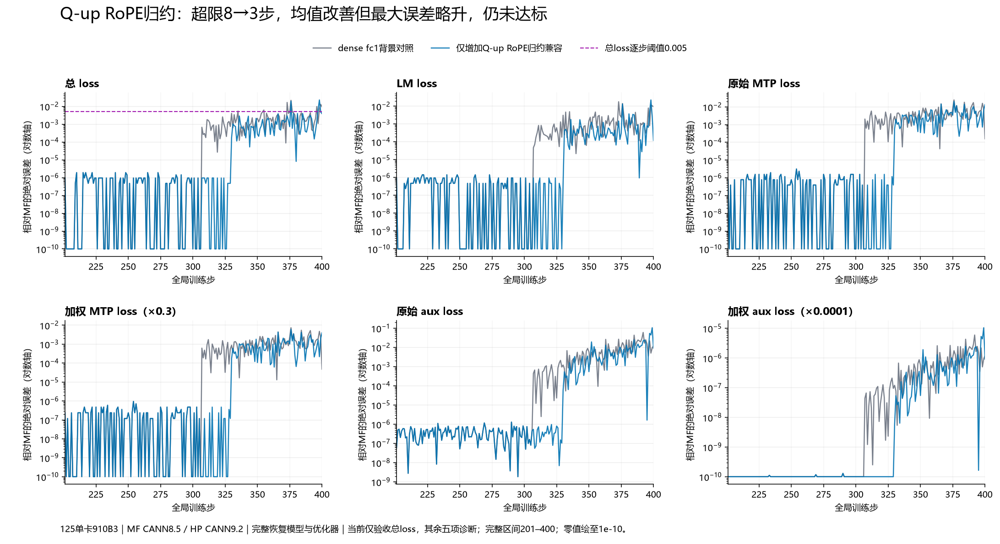

# 第306步 Q-up RoPE：条件性因果验证与第98组完整200步

第98组独立200步仍未通过。相对dense fc1背景只扩大Q-up归约兼容到RoPE分块，总loss超0.005步数8→3，均值0.001157287359237671→0.0006631982326507569；但最大误差0.021615982055664062→0.022772789001464844，略有退步。超限为376、397、398，不能用平均值或197步通过替代全窗验收。

完整配置、上一阶段的数学正确性和行业实现对照见[293阶段记录](阶段记录-293DenseFC1归一化与306边界.md)。HP仍为JT_dev e21302f9＋PR192，集成提交181fab5f5c31ceeb2e385c1267aa586d5c6c8835，CANN9.2.0-beta.2；MF原压缩包、CANN8.5.0。125单卡910B3、4K Arrow、Muon＋AdamW和MF200完整状态恢复均不变。

## 1. 为什么重测曾经没有收益的RoPE因素

第94/95组在未加入dense fc1修正的背景下，增加RoPE归约没有任何200步标量增量收益，此阴性结果保留。第97组加入fc1归约后形成另一条训练轨迹，新的已测分叉在306更新后，唯一不同模型参数是第0层Q-up。因此重新测试RoPE是针对新边界的条件消融，不是推翻旧实验或盲目添加因素。

[306/307原生统计](evidence/frontier307-native-statistics-comparison.json)已证明：306全部46组原始梯度、平方和与全局范数精确；更新后仅model.layers.0.self_attn.q_b_proj.weight不同；307才传播到46组梯度。

## 2. 目标状态与完整更新重放

选定参数形状24576×1536，共37748736个FP32元素；按128个头拆为非RoPE的16384×1536及RoPE的8192×1536。

[完整状态审计](evidence/frontier306-state-comparison.json)确认：

| 边界 | 结果 |
|---|---|
| 305目标权重和Muon动量 | 各37748736元素精确 |
| 306裁剪后目标梯度 | 37748736元素精确 |
| 306更新后目标动量 | 37748736元素精确 |
| 306更新后目标权重 | 7966424个FP32差异、67544个BF16差异，最大绝对差6.85080885887146e-6 |

本次305/306全模型哈希探针误写空范围range(305,259)，没有生成全模型记录；原源、失败审计保留。目标状态数组已完整采集，306目标权重与此前独立原生统计组的模型哈希精确关联，两侧106步输入、指标、恢复和既有因素均保真。没有据此声称305的所有48个模型精确。修订审计只调整证据引用和范围声明，不修改训练数据；早期措辞修订副本亦保留。

HP原始控制、HP独立候选和MF原生更新均在空闲卡隔离重放。[重放联合审计](evidence/frontier306-muon-boundaries.json)核对源文件、启动脚本、原生Dump配置和完整最终状态：

- 原HP控制精确重现自己的完整306权重及动量。
- 原MF直接调用归档_apply_muon_update，原生Dump开启后完整权重及动量仍精确实际MF训练。
- 候选只依据自己的实时输入计算，完整权重及动量精确MF；参考值仅用于结果算完之后的比较。

## 3. 原生统计将首差缩到RoPE归一化

本次只保存两个归一化融合算子的6条统计/hash记录和DVM文本，没有保存全量算子数组。原生输入布局和FP32标量字节分别校验，不能从打印的低精度小数反推真实值。

| 项目 | 非RoPE | RoPE |
|---|---|---|
| 完整pre_norm与MF一致 | 是 | 是 |
| 控制归一化输出与MF一致 | 是 | 否 |
| 独立归约平方和与MF原始字节一致 | 是 | 是 |
| 独立归约完整BF16输出与MF一致 | 是 | 是 |
| 控制/候选NS输出一致 | 是 | 否 |

[原生CSV](evidence/frontier306-native-normalization-stat.csv)、[原生更新图](evidence/frontier306-native-update-graph.ir)、[原生DVM](evidence/frontier306-native-dvm.txt)。

RoPE控制范数0.49498993158340454、分母0.4949900209903717；候选从实时输入独立得平方和0.2450150102376938、范数0.49498990178108215、分母0.4949899911880493。使用已在[258七组输入](evidence/frontier258-norm-holdout-audit.json)验证的9776元素分块、40核合并和设备FP32开方，没有添加306专用常量或步数判断。

同公式FP64范数为0.49498993770475036。两种实际BF16归一化表示有73348个不同值，全部是控制HP更近，MF更近0个；全张量平均绝对误差分别2.998691715222499e-7与2.9986941147593493e-7。两者最大误差相同1.5196479275263013e-5。因此本项仍归类为旧MF数值兼容，不能称为HP数学算法缺陷。

## 4. 短程消除分叉，完整窗口仍有残差

[独立短程审计](evidence/frontier306-qup-both-native-statistics-comparison.json)证明306和307均达到46/46梯度、46/46平方和、全局平方和/范数及48/48 FP32/BF16模型精确；与完整候选前107步指标、输入和恢复一致。

[完整200步审计](evidence/frontier306-qup-both-independent200-audit.json)确认200份输入、恢复、49份冻结来源、既有因素和全部实时调用通过；启动器相比第97组只有Q-up scope=nope→both及必要输出/设备/端口变化。

| 总loss指标 | 第97组fc1背景 | 第98组增加RoPE |
|---|---:|---:|
| 首步绝对误差 | 9.5367431640625e-7 | 同左 |
| 最大绝对误差 | 0.021615982055664062 | 0.022772789001464844 |
| 最大误差步 | 376 | 398 |
| 平均绝对误差 | 0.001157287359237671 | 0.0006631982326507569 |
| 超0.005步数 | 8 | 3 |
| 首次超限 | 335 | 376 |
| 最后一步误差 | 0.009406089782714844 | 0.0038747787475585938 |
| 首次梯度范数不同 | 307 | 330 |
| 总loss验收 | 不通过 | 不通过 |

均值改善约42.69%，最大值增加约5.35%。诊断分量：LM最大误差0.022550582885742188；加权MTP 0.0060787200927734375、原始MTP 0.020262400309245088；加权Aux 1.05498047545552e-5、原始Aux 0.10549804754555225。Aux原值最大值退步也保留，不把加权数值较小说成其原值对齐。当前只验收总loss，MTP/Aux专项仍未开始。

配置：[YAML](configs/hp-jte213-fc1norm-qupboth400.yaml)、[启动脚本](launchers/run-hp-jte213-fc1norm-qupboth400.sh)、[启动回执](evidence/hp-jte213-fc1norm-qupboth400-launch.json)，卡7、端口31680。短程卡6端口31681；双边状态卡4/5；单参数重放卡0/1/2，均为各自独立单卡。

## 5. 当前排序、后续边界与提交原则

1. 继续定位329/330边界：总loss仍有3步超限，当前完整轨迹首次范数不同在330。新双边观测只采329/330统计与模型哈希；尚未得到结果时，不判定是前向、反向还是更新。
2. 保留已验证的dense fc1及RoPE兼容因素作当前对照，分别报告它们在对应背景中的收益；不得把不同轨迹的改进比例相加。
3. 已被单参数替换消除的306/307多处梯度差异归为传播结果，不重复申报根因。
4. 控制归一化更接近FP64而候选更接近旧MF，需维持数学正确性与旧版本兼容的区别。现代MF/Megatron行业源码及完整讨论见293阶段第5节；固定形状CPU归约原型不直接进入产品默认实现。

必要产品修复继续独立中文子issue和PR：215→213、187→192、216→180，均由总issue217关联。当前没有证明新的通用接口或数学契约错误，不为了每个兼容因素机械提交产品PR。

第357步旧教师诊断检查点已按用途清理：保留原模型/优化器清单、STATE、各文件SHA256和历史运行日志，释放27972650896字节。它从未计入独立验收；MF200和当前必要状态保留。[清理回执](evidence/frontier306-obsolete-anchor357-cleanup.json)。本阶段所有原生算子重放仅保存统计/hash，避免再次堆积完整张量。
