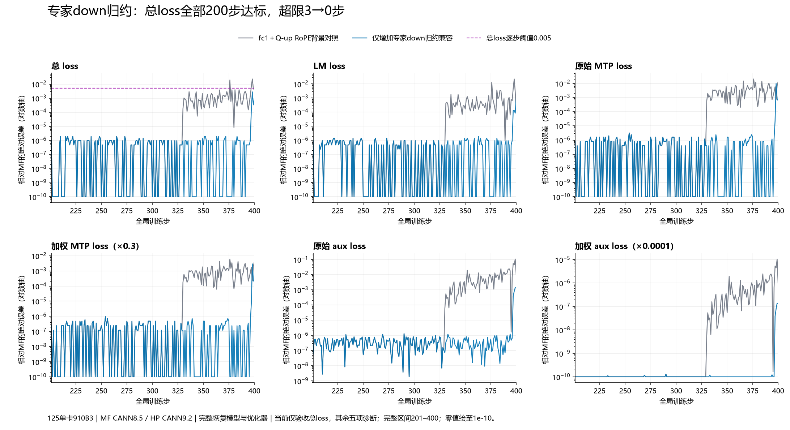

# 第328步专家归一化：时间缩小、算子二分与独立消融

## 当前验收与实验边界

当前仅验收总loss：第201步绝对差≤0.001，201–400每一步绝对差≤0.005。此前98组独立完整200步均未通过，最佳最新组合仍有376、397、398三步超限。第99组独立200步现已完成并通过当前总loss验收；不是只凭单次重放宣告成功。按用户约定停止进一步训练，MTP/Aux专项等待交互后决定。

本阶段从第98组背景增加一个因素：专家down归一化的归约次序。HP使用已核验JT_dev e21302f9与PR192集成提交181fab5f，CANN9.2.0-beta.2；MF仍是指定压缩包源码，CANN8.5.0。单卡、4K Arrow、Muon＋AdamW、MF200完整模型与优化器恢复，以及其他已有因素保持不变。机器125实际设备为910B3。本阶段未修改129或zth目录，也未停止其他用户作业。

## 从首次观测到真正首差

最初在329/330取得完整原生统计：329全部46项裁剪前梯度、平方和、全局范数精确，但更新后专家down不同；330梯度开始扩散。这只能证明329观测到了权重差，不能断言329更新是首因。

补采328/329真实状态后，发现328权重已不同。因此撤销最初“329更新首差”的推断，保留原记录与修正。307此前模型一致，随后在307–328只记录目标权重、动量和每专家的完整哈希：307–327均一致，328首次仅专家0权重不同。再补采327/328两步全部48项模型哈希及目标数组，验证真正边界。

| 边界 | 结果 |
|---|---|
| 327全模型48项FP32/BF16 | 全部一致 |
| 327目标权重、Muon动量 | 全部62,914,560元素一致 |
| 328完整裁剪后梯度 | 全部62,914,560元素一致 |
| 328更新后Muon动量 | 全部一致 |
| 328更新后模型 | 仅`model.layers.1.mlp.experts.down_proj`不同，目标内部仅专家0 |
| 328目标权重差异 | FP32位差7,294,860；BF16差129,175；最大绝对差1.3802200555801392e-5 |

两端128步观测退出0，所有输入、指标、恢复、配置、冻结源码均与对应原轨迹保真。328端点还与前次独立329状态采集互相核对。MF原始形状`(12288,5120)`经`reshape(8,1536,5120).transpose(0,2,1)`对齐HP的`(8,5120,1536)`，映射与实际转换器一致。

证据：[时间定位](evidence/frontier329-temporal-first-difference.json)、[327/328状态审计](evidence/frontier328-state-comparison.json)、[329差异继承负面对照](evidence/frontier329-inherited-weight-comparison.json)。

## 继续二分：归一化 → NS → 权重写回

HP和MF分别使用各自327真实状态与328真实梯度重放一次Muon更新。MF调用压缩包原始更新函数；两端先精确复现各自实际训练的完整目标权重和动量，之后才使用中间观测归因。

原生Dump与HP完整哈希比较显示，归一化之前的BF16输入一致；第0专家归一化分母不同，其余7个一致。后续完整normalized、NS输出和权重依次不同。

| 专家0标量 | HP原路径 | MF路径／独立兼容重算 |
|---|---:|---:|
| FP32平方和 | 0.0014227700885385275（显式普通求和） | 0.0014227703213691711 |
| 设备FP32范数 | 0.03771962597966194 | 0.03771962970495224 |
| BF16分母 | 0.03759765625 | 0.037841796875 |

BF16两值中点为0.0377197265625。微小归约误差经过设备开方、epsilon和BF16舍入跨越分界；不能仅凭平方和差值小就降级，也不能凭大量权重位差就认定完整loss影响大。

完整原生输入SHA1为`d3002f204d13f74ab60eaed1ae5fb6bde86fc520`；MF normalized为`60c3e43b76e18876d870d678161c2b445785dc00`，NS输出为`aa00b5cdf1a252700e07bad0fc69fcef28146f27`。这些采用已核验MindSpore原生分块哈希组合，覆盖全部元素，不是只比较打印小数。

## 单因素及负面对照

| 改动 | 第328步完整更新结果 | 判断 |
|---|---|---|
| 原HP控制 | 精确复现HP实际训练 | 重放保真通过 |
| 只将epsilon改成旧图BF16表示 | 仍精确等于HP，未对齐MF | 本边界无作用，降低优先级 |
| 普通FP32平方和＋NPU开方 | 仍精确等于HP | 不能仅改表达式就归因成功 |
| 上项＋BF16表示epsilon | 仍精确等于HP | 组合仍无作用 |
| DVM实际归约次序，epsilon保持1e-7 | 全部目标权重逐位等于MF；动量不变 | 归约因果成立 |
| DVM归约＋BF16表示epsilon | 与前项完整结果相同 | 本次不需要额外改变epsilon |

邻近329输入为独立对照：它原本normalized/NS已一致。相同DVM归约规则得到8/8精确平方和、分母及完整normalized/NS，完整更新与原HP一致。329起始权重已继承328差异，所以本对照不声称329最终权重等于MF。

候选只从HP实时输入计算，不读取MF参考标量、梯度或权重，不按训练步或元素坐标特判。全程固定作用于已测量的`(8,5120,1536)`形状，每步两次。

证据：[简单候选负面对照](evidence/frontier328-hp-normalization-screen.json)、[真实328与邻近329联合审计](evidence/frontier328-native-cause-audit.json)、[候选源码](scripts/hp_expert_norm328_factor.py)。

## 官方DVM源码与实测验证

真实MF DVM日志记录：10240元素tile、768个tile／专家、64个lane、8个专家，`block_dim=20`。只看到这些数字仍不足以猜出跨核分组。

固定官方DVM参考提交[a36395c4…](https://gitcode.com/mindspore/dvm/blob/a36395c4f66cbdbb8a9104075af611d9e5f230de/src/vm_aiv.cce)：`ReduceSumX`先沿行折半归约，再做lane归约；`VisitRed_1`根据总向量核数和专家数分组；`ReduceJoin`先合并本核tile，再按核合并。结合实际调度推导出40个向量核、每专家5核，而不是每专家20／40核。

使用真实328与329输入分别验证：160×64 tile行折半、lane相邻相加、5核跨步累加、核顺序合并，两组均8/8平方和逐位一致。2核候选和lane折半候选没有全部通过。此前329的90个泛化候选最多4/8一致，作为失败筛选保留，不当作定位证据。

该官方提交是明确固定的参考，**尚未核实它就是容器DVM二进制的编译提交**。实际输入、原生平方和、完整输出及训练重放的一致性，是本阶段采用该次序的直接证据。[两组归约验证](evidence/frontier328-329-dvm-schedule-screen.json)、[真实DVM日志](evidence/frontier328-native-dvm.txt)。

## 哪个更正确：高精度与现代实现分开评价

同一个实际BF16输入，用FP64计算Frobenius范数和除法，并固定数学epsilon为1e-7。CPU重构的HP/MF完整BF16归一化结果均先通过原生完整哈希校验，再比较精度。

| 专家0比较 | 结果 |
|---|---:|
| FP64范数 | 0.0377196251302085 |
| HP范数绝对误差 | 8.494534381453533e-10 |
| MF兼容范数绝对误差 | 4.574743736607267e-9 |
| 不同BF16归一化值 | 7,590,502 |
| HP更接近FP64 | 3,982,362 |
| MF更接近FP64 | 3,608,140 |
| HP归一化平均绝对误差 | 6.454506453936218e-7 |
| MF归一化平均绝对误差 | 6.671751618057443e-7 |

因此这一输入上，原HP的范数和平均归一化误差更好；两个实现分别在部分元素更接近参考。不能将“兼容MF”表述成普遍精度修复，也不能由此断言整个优化器或框架谁统一正确。见[完整精度记录](evidence/frontier328-normalization-precision.json)。

2026-10-16 17:28重新核对MF官方master为[1c9258ca…](https://gitcode.com/mindspore/mindformers/blob/1c9258ca845e21ddd66fde83e262d5635359bd30/mindformers/pynative/optimizer/muon.py)，其PyNative Muon文件SHA256为`9e9e5867a4225181a7014ca7809bae67d16e9bfa103a7316fb71aaa20a7fee7c`，与此前固定参考内容相同。1195–1199行以FP32 Frobenius范数、`clamp(min=eps)`归一化，再转BF16，并不要求复现归档图的5核归约或BF16分母路径。

Megatron当前的Muon入口委托到Emerging Optimizers；[NVIDIA官方0.4.0版本源码](https://docs.nvidia.com/nemo/emerging-optimizers/0.4.0/_modules/emerging_optimizers/orthogonalized_optimizers/muon_utils.html)的`newton_schulz`要求FP32输入，单卡默认使用`functional.normalize`，可选择FP64范数。不据此把旧图特定归约次序设为产品默认。本阶段归为归档路径兼容因子，只有出现需要修正的产品契约问题才单独建立子issue和PR。

## 独立200步与优先级

第99组`hp-jte213-expertnorm328400`在125卡4、端口31699完成200步并退出0；独立观测组
`hp-jte213-expertnorm328-preclip330`在卡5、端口31700完成130步并退出0。两组均从MF200完整状态恢复。
48项完整轨迹保真检查均通过：实际输入、完整恢复、配置、49冻结来源、既有因素和实际调用保持一致；
只新增实时专家down归约，epsilon仍为1e-7。观测组前130步所有指标精确复现完整组。

| 指标 | 首步绝对差 | 200步最大绝对差 | 最大差所在步 | 平均绝对差 | 第400步绝对差 |
|---|---:|---:|---:|---:|---:|
| 总loss（当前验收） | 9.53674316406e-07 | 0.00276947021484 | 398 | 2.11477279663e-05 | 0.000879287719727 |
| LM | 9.53674316406e-07 | 0.00105857849121 | 400 | 7.47680664062e-06 | 0.00105857849121 |
| MTP加权 | 2.38418579102e-07 | 0.00290107727051 | 398 | 1.68332457542e-05 | 0.000179290771484 |
| MTP原始 | 7.94728597597e-07 | 0.00967025756836 | 398 | 5.61108191808e-05 | 0.000597635904947 |
| Aux加权 | 5.86733222771e-12 | 1.38258654624e-07 | 399 | 1.97175214998e-09 | 1.31199508905e-07 |
| Aux原始 | 5.86733222008e-08 | 0.00138258654624 | 399 | 1.97175214998e-05 | 0.00131199508905 |

总loss首步9.5367431640625e-7≤0.001；全部201–400步均≤0.005，最大0.00276947021484375@398，
0步超限。对照第98组最大0.022772789001464844、平均0.0006631982326507569、3步超限；
本次最大和平均误差分别下降87.84%、96.81%。这是同背景单因素的实测收益，
不能与不同背景历史因素线性相加，也不证明该因素单独应用于原始HP就足够。

独立原生统计复核：329、330两步各46项裁剪前梯度、46项平方和、总平方和、全局范数，
以及48项FP32/BF16模型哈希全部精确。此前观察到的328权重首差与330传播差消失。
完整组第一次梯度范数差现在出现在397，但总loss已满足阶段门槛，按约定没有继续追查或启动MTP/Aux专项。
原始MTP最大差0.009670257568359375仍高于0.005，原始Aux最大0.001382586546242237；
两者是当前记录的诊断结果，不扩大本阶段验收，也不隐去原始MTP残差。

优先级结论：专家down归约是第98→99组背景下直接使总loss过线的首要因素；epsilon和普通sum/sqrt候选
在同328完整更新上没有效果，降级；更早fc1和Q-up等因素保留其条件性收益及负面项。没有再增加因素。

[200步逐步及48项保真审计](evidence/frontier328-expert-independent200-audit.json) ·
[329/330原生统计与全模型](evidence/frontier328-expert-native-statistics-comparison.json) ·
[99组完整实验清单](evidence/completed-cann92-inventory.csv)

## Dump、失败记录和磁盘

MF先用一个更新、一个iteration的统计Dump，只保存hash/max/min/L2与图；定位后只取8个平方和、8个分母。逻辑原生payload48字节，Dump将BF16输出按FP32保存，因此实际标量payload64字节，另加NPY头。未全量落盘算子输入输出。

状态审计脚本两处`FC1283`文件名为机械替换错误，v2改回真实`FC1293`；另一联合审计对329旧标量格式错误假定有`complete`字段，v2改为对两组标量重新计算并核验原生CSV哈希。原源和失败信息保留，没有改写训练结果或跳过验证。

已完成阶段293的14个临时数组清理5,033,166,592字节，阶段306的11个临时数组清理1,660,945,792字节。删除前核对任务路径、单硬链接、capture退出、完整审计和无进程打开，并保留每文件SHA256、原元数据及复现入口。随后在因果、高精度、邻近输入和完整200步审计完成后，清理328/329的22个临时数组，逻辑字节5,536,484,096、分配字节5,536,571,392；原元数据和完整哈希保留。这三批共清理逻辑字节12,230,596,480。MF200起点、离线HP200和原始共享数据保留；已清理的边界数组需按入口重新生成，不能直接重跑依赖这些数组的离线分析。[328/329清理回执](evidence/frontier328-completed-boundary-state-cleanup.json)。[293回执](evidence/frontier329-completed293-state-cleanup.json)、[306回执](evidence/frontier328-completed306-state-cleanup.json)。
